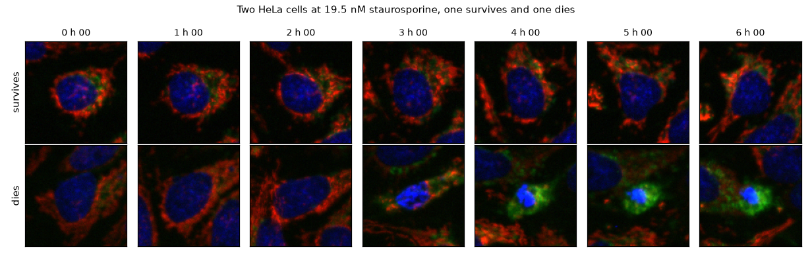

# static2fate

[](https://github.com/MMatinGerami/static2fate/actions/workflows/ci.yml)
[](LICENSE)
[](https://github.com/MMatinGerami/static2fate/releases)
<!-- After enabling the repo on zenodo.org (GitHub integration) and cutting v0.1.1, add:
[](https://doi.org/10.5281/zenodo.XXXXXXX) -->

From one image of a drug-treated cell, can we tell which of two futures it will take, and when
that became decided?

**In one line:** 6,676 HeLa cells tracked for 6 h under a staurosporine dose series, each with a
known fate (S-BIAD2515, CC0); a fate-conditioned flow-matching model written from scratch that
generates both futures of the same cell; and a measured answer to "when": from a single frame,
fate is not readable before about 2 h and largely readable by 4 h.



*The same starting cells take two fates. Left: a cell that survives; right: a cell that condenses
its nucleus and dies. Frames every 30 min, AnnexinV at 6 h.*

## Results at a glance

| Question | Answer | Where |
|---|---|---|
| When is fate readable from one frame? | Within 19.5 nM, leave-one-field-out AUROC 0.51 at 0 min, 0.60 at 2 h, 0.78 at 4 h, 0.84 at 6 h | [docs/results.md](docs/results.md#findings-so-far), fig 2 |
| Do frozen foundation encoders see it earlier? | No. Eleven handcrafted nuclear measurements match or beat frozen DINOv2 at every informative dose; V-JEPA 2 on frames 1 to 8 is 0.045 worse than one frame of handcrafted features (95% CI -0.067 to -0.021) | `results/tables/vjepa_vs_frame.csv` |
| Does the generated future follow the right cell? | For 72% of cells that die with a condensed nucleus, the model's 6 h prediction is closer to the real cell than its own 0 h frame is (95% CI 54 to 80%); per-cell nucleus-size predictions correlate with the real future as well as copying does (Spearman 0.50) and better for AnnexinV-only dying cells (0.48 against 0.23) | [docs/results.md](docs/results.md#starting-from-a-real-cell) |
| Does more compute help? | Eight times the training steps or twice the resolution moves the readout scores by less than 0.1; the images do look more real (DINOv2 distance to a random real cell 0.7 to 1.4 against 3.0 to 5.4). Beyond that the loss is flat: 8 more hours, with or without a VGG16 perceptual term, changed nothing | fig 11, fig 12b, [docs/results.md](docs/results.md#training-for-realism) |
| What is still wrong | A linear probe tells generated from real with AUROC above 0.99; generated dying cytoplasm turns green where real dying cells end red and blue; the generated future is not recognisable as this cell's in DINOv2 space | fig 13 |

Dose matters: both fates occur in one band, 9.8 to 39 nM. Static2Dynamic's ChromaLive model
([Boyer et al., 2026](https://doi.org/10.64898/2026.05.18.725860)) was trained at 78 and 156 nM,
where nearly all cells die.

| dose (nM) | 0 to 2.4 | 4.9 | 9.8 | 19.5 | 39.1 | 78 | 156 |
|---|---|---|---|---|---|---|---|
| fraction apoptotic at 6 h | 0.11 to 0.17 | 0.19 | 0.19 | 0.31 | 0.74 | 0.91 | 0.92 |

## Quickstart

One well is about 1.5 GB and runs on a laptop; all 30 wells are 45 GB.

```bash
uv sync
scripts/00_download_subset.sh C-06      # one well of S-BIAD2515 (CC0); no argument = all 30 wells
scripts/run_all.sh                       # segmentation, tracking, fate labels, single-frame baselines
```

Then the models (Apple M5 Pro, MPS; a GPU is faster):

```bash
uv run scripts/09_train_flow.py --minutes 45     # fate-conditioned flow model, then scripts 10 to 15 to evaluate
uv run scripts/13_train_ctx.py --minutes 60      # same model given an earlier frame of the cell
uv run pytest
```

On a GPU: `uv run scripts/export_kaggle.py <user>` writes the 2,735 cells the models use (1.7 GB);
`kaggle/train_kaggle.py` trains from it on Kaggle.

## When to use this

- You have live-cell movies with a terminal fate stain and want a tracked single-cell dataset
  with fate labels (`src/static2fate/fields.py`, `tracking`, `labels`).
- You want a tested baseline for "how early is fate readable", including frozen DINOv2 and
  V-JEPA 2 against handcrafted features.
- You want a small conditional flow-matching model (`src/static2fate/flow.py`, 9.4 M parameters,
  45 min on a laptop) to adapt to your own crops, with the evaluation scripts (energy score,
  identity rank, per-cell skill) that go with it.

Not a general cell tracker and not a production model: one plate, one cell line, one drug.

## What is here

- Nuclear segmentation, tracking over 13 frames and registration of the terminal AnnexinV image
  for all 30 wells (119 fields): 6,676 cells followed from start to end with a fate label.
- Fate label: AnnexinV above the control 90th percentile inside a cell mask, or a condensed
  nucleus (area halved, Hoechst doubled). Replicate wells agree within a few points.
- Single-cell crops (13 frames x 3 channels x 128 px) and single-frame fate baselines.
- Two flow-matching models (fate-conditioned; fate plus an earlier frame), their Kaggle runs at
  8x the steps and 2x the resolution, and the paired and SDEdit-style variants that did not help.

## Limitations

- One plate; the label fixes a 10% positive rate in controls.
- Tracking keeps a quarter to half of cells, fewer in dense regions, and almost none that divide,
  so every model is trained on cells that did not divide during the movie.
- At most 2.1% of "dying" labels may be mitotic cells caught rounding up.
- Two deposited files are truncated and the deposited terminal images need field matching
  (handled in `src/static2fate/fields.py`).

## Full results

Every experiment, table and figure, in the order it was run, is in
[docs/results.md](docs/results.md). Dated notes, decisions and corrections are in
[notes/notebook.md](notes/notebook.md).

## Citation

```bibtex
@software{gerami2026static2fate,
  author  = {Gerami, Matin},
  title   = {static2fate: single-cell fate from live-cell imaging},
  year    = {2026},
  version = {0.1.0},
  url     = {https://github.com/MMatinGerami/static2fate}
}
```

Data: S-BIAD2515, Lippincott et al., Way lab, CC0
([BioImage Archive](https://www.ebi.ac.uk/biostudies/BioImages/studies/S-BIAD2515)).

## License

MIT
