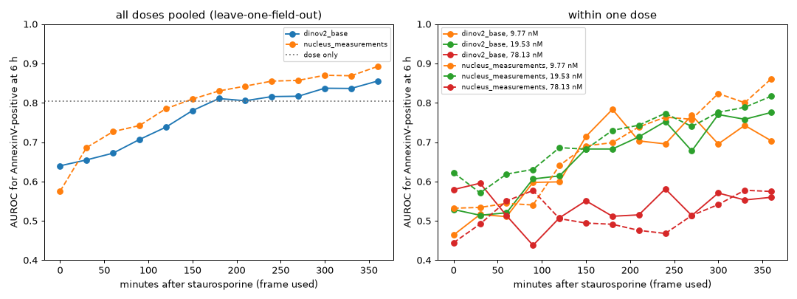

# static2fate

From one image of a drug-treated cell, can we tell which of two futures it will take, and when
that became decided?

Static2Dynamic ([Boyer et al., 2026](https://doi.org/10.64898/2026.05.18.725860)) generates a
video of a process from static snapshots, assuming one trajectory. This project works where the
same starting cells take two: HeLa cells under a staurosporine dose series, filmed every 30 min
for 6 h and then stained for AnnexinV, so every cell has a video and a known fate
([S-BIAD2515](https://www.ebi.ac.uk/biostudies/BioImages/studies/S-BIAD2515), Lippincott et al.,
Way lab, CC0).

Status (October 2026): data pipeline and baselines done; generative modelling not started.

## What is here

- Nuclear segmentation, tracking over 13 frames and registration of the terminal AnnexinV image
  for all 30 wells (119 fields): 6,676 cells followed from start to end with a fate label.
- Fate label: AnnexinV above the control 90th percentile inside a cell mask, or a condensed
  nucleus (area halved, Hoechst doubled). Replicate wells agree within a few points.
- Single-cell crops (13 frames x 3 channels x 128 px) and single-frame fate baselines.

## Findings so far

| dose (nM) | 0 to 2.4 | 4.9 | 9.8 | 19.5 | 39.1 | 78 | 156 |
|---|---|---|---|---|---|---|---|
| fraction apoptotic at 6 h | 0.11 to 0.17 | 0.19 | 0.19 | 0.31 | 0.74 | 0.91 | 0.92 |

- Both fates occur in one band, 9.8 to 39 nM. Static2Dynamic's ChromaLive model was trained at
  78 and 156 nM, where nearly all cells die.
- From a single frame, fate is not readable before about 2 h and largely readable by 4 h
  (within 19.5 nM, leave-one-field-out AUROC 0.51 at 0 min, 0.60 at 2 h, 0.78 at 4 h, 0.84 at 6 h).
- Eleven handcrafted nuclear measurements match or beat frozen DINOv2 at every informative dose.
- A frozen video encoder does not see fate earlier either: V-JEPA 2 on frames 1 to 8 reaches
  within-dose AUROC 0.64 at 3.5 h against 0.68 for one frame of handcrafted features
  (difference -0.045, 95% CI -0.067 to -0.021; `results/tables/vjepa_vs_frame.csv`). It does
  beat DINOv2 averaged over the same frames at 2.5 h (+0.036, CI 0.007 to 0.067).



## Next

Train Static2Dynamic on the two-fate doses, then a version conditioned on fate whose two
generated branches can be compared with real videos, with the 2 to 4 h window above as the check
on when they should separate.

## Run

```
uv sync
scripts/00_download_subset.sh          # all 30 wells, 45 GB, from EBI
scripts/run_all.sh                      # segmentation to baseline
```

Notes, decisions and corrections are dated in [notes/notebook.md](notes/notebook.md).

Known limits: one plate; the label fixes a 10% positive rate in controls; tracking keeps a
quarter to half of cells, fewer in dense regions; two deposited files are truncated and the
deposited terminal images need field matching (handled in `src/static2fate/fields.py`).
