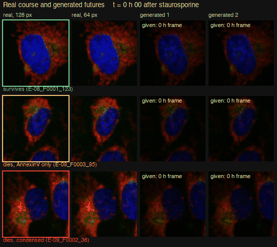
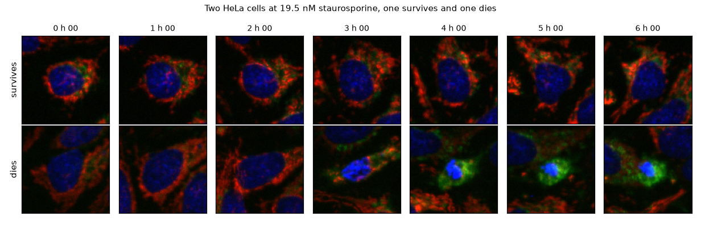

# static2fate

[](https://github.com/MMatinGerami/static2fate/actions/workflows/ci.yml)
[](LICENSE)
[](https://github.com/MMatinGerami/static2fate/releases)
<!-- After enabling the repo on zenodo.org (GitHub integration) and cutting v0.1.1, add:
[](https://doi.org/10.5281/zenodo.XXXXXXX) -->

From one image of a drug-treated cell, can we tell which of two futures it will take, and when
that became decided?

**In one line:** 6,676 HeLa cells tracked for 6 h under a staurosporine dose series, each with a
known fate (S-BIAD2515, CC0); a fate-conditioned flow-matching model written from scratch that
generates both futures of the same cell; and a measured answer to "when": from a single frame,
fate is not readable before about 2 h and largely readable by 4 h.



*Held-out cells over 6 h (one per fate group, 128 px and the 64 px the generator works at)
next to two futures drawn by the video model from the 0 h frame alone. Until 3 h the generated
columns show the frame the model was given; from 3 h on they play its clip. More cells per
group in `results/movies/`, and a whole field with every tracked nucleus outlined by its fate
in `results/movies/field_E-08_F0001.gif` (`scripts/36_movies.py`).*



*The same starting cells take two fates. Left: a cell that survives; right: a cell that condenses
its nucleus and dies. Frames every 30 min, AnnexinV at 6 h.*

## Results at a glance

| Question | Answer | Where |
|---|---|---|
| When is fate readable from one frame? | Within 19.5 nM, leave-one-field-out AUROC 0.51 at 0 min, 0.60 at 2 h, 0.78 at 4 h, 0.84 at 6 h | [docs/results.md](docs/results.md#findings-so-far), fig 2 |
| Do frozen foundation encoders see it earlier? | No. Eleven handcrafted nuclear measurements match or beat frozen DINOv2 at every informative dose; V-JEPA 2 on frames 1 to 8 is 0.045 worse than one frame of handcrafted features (95% CI -0.067 to -0.021) | `results/tables/vjepa_vs_frame.csv` |
| Does the generated future follow the right cell? | For 72% of cells that die with a condensed nucleus, the model's 6 h prediction is closer to the real cell than its own 0 h frame is (95% CI 54 to 80%); per-cell nucleus-size predictions correlate with the real future as well as copying does (Spearman 0.50) and better for AnnexinV-only dying cells (0.48 against 0.23) | [docs/results.md](docs/results.md#starting-from-a-real-cell) |
| Does more compute help? | Eight times the training steps or twice the resolution moves the readout scores by less than 0.1; the images do look more real (DINOv2 distance to a random real cell 0.7 to 1.4 against 3.0 to 5.4). Beyond that nothing moves: 8 more hours, a VGG16 perceptual term, four times the parameters or three times the cells all give the same scores, and from the same noise the wide models draw nearly the same image as the small one (pixel difference 0.03 against 0.16 between two samples) | fig 11, fig 12b, [docs/results.md](docs/results.md#training-for-realism) |
| Is the predicted future one trajectory? | Not frame by frame: independent draws make the nucleus jump 150 to 190 px between hours (real cells 100 to 120) and change direction at random. A video model that draws the 3 to 6 h clip jointly (temporal attention after every UNet stage) matches real cells on both (98 to 105 px; 0.74 reversals for condensing cells against 0.65 real). Started from the trained frame model, it also matches the frame model on every per-frame score, so the two are had together | fig 15, [docs/results.md](docs/results.md#the-future-as-one-clip-not-one-frame-at-a-time) |
| What does the realism probe measure? | Less than it seemed. The DINOv2 probe also tells a 33 dB autoencoder reconstruction from the real cell (AUROC 0.995) and a 1 px Gaussian blur of the real frame from it (1.000), while a blur of half a pixel scores 0.87 and matched noise changes nothing: above 0.99 it is saturated on sub-pixel texture. The handcrafted probe at 128 px ranks them: generated frames 0.75, a 1 px blur 0.74, the reconstruction 0.67 | [docs/results.md](docs/results.md#what-survives-the-autoencoders-latent-and-what-the-probe-reads), fig 16 |
| Does generating in a latent help? | For texture, yes: the frame and video models on the 4 x 32 x 32 codes of the autoencoder bring the handcrafted probe at 128 px from 0.75 to 0.64, past the reconstruction's own 0.67, where no pixel-space change had moved it. For content, no: the generated future is as far from the cell's own in DINOv2 space as before (identity rank 0.44), and the latent frame model's nucleus-area skill in condensing cells drops (0.17 against 0.35); the latent video model recovers it (0.38) and keeps real cells' smoothness. Masking the crops to the cell before DINOv2 reverses the order: the latent models get the cell right (at the nucleus, as close to its own future as a random same-fate cell) and invent the surroundings, the pixel model keeps the surroundings and blurs the cell. Twice the steps for the latent frame model and a warm start of the latent video model from it change none of this, so the gap is not training budget. Nor does holding the 0 h neighbourhood by anchoring the sampler outside a disc (tag `_anchor`): the rim is kept to 0.2 grey levels and every score gets worse, and a 6 h old neighbourhood is further from the real frame than a random cell's even with the real 6 h cell pasted in, so the neighbours' futures have to be predicted too | [docs/results.md](docs/results.md#generating-in-the-latent), fig 14b, fig 15, fig 18 |
| What does the energy score count? | Mostly spread. ES = mean distance to the real frame minus half the mean distance between samples; split into the two terms (`scripts/42_energy_terms.py`), every model since the 8 h one sits at the same distance from the cell's own future (36 to 38 DINOv2 units at 64 px, 2 closer than a random same-fate cell and no closer than the 0 h copy, except for condensing cells) and the differences between models read off "model minus random" so far are the spread of their samples. The latent models' advantage at the nucleus is a distance (3 to 4 units for survivors); the pixel model's on the whole crop was diversity. Against the 0 h copy the models are closer only for condensing cells, and further for AnnexinV-only dying cells, whose nuclei every model redraws as condensing | [docs/results.md](docs/results.md#what-the-energy-score-was-counting), `results/tables/energy_terms_anchor.csv` |
| What is still wrong | No model is closer to the cell's own future than its 0 h copy except for condensing cells, and all of them redraw AnnexinV-only dying nuclei as condensing; keeping the 0 h surroundings by force does not help and the neighbours' futures have to be predicted as well; generated dying cytoplasm turns green where real dying cells end red and blue; the generated future is not recognisable as this cell's in DINOv2 space (as far from it as a random real cell, where the reconstruction is 28 units closer) | fig 13 |

Dose matters: both fates occur in one band, 9.8 to 39 nM. Static2Dynamic's ChromaLive model
([Boyer et al., 2026](https://doi.org/10.64898/2026.05.18.725860)) was trained at 78 and 156 nM,
where nearly all cells die.

| dose (nM) | 0 to 2.4 | 4.9 | 9.8 | 19.5 | 39.1 | 78 | 156 |
|---|---|---|---|---|---|---|---|
| fraction apoptotic at 6 h | 0.11 to 0.17 | 0.19 | 0.19 | 0.31 | 0.74 | 0.91 | 0.92 |

## Quickstart

One well is about 1.5 GB and runs on a laptop; all 30 wells are 45 GB.

```bash
uv sync
scripts/00_download_subset.sh C-08      # one well of S-BIAD2515 (CC0), 19.53 nM, both fates; no argument = all 30 wells
scripts/run_all.sh                       # segmentation, tracking, fate labels, single-frame baselines
```

Then the models (Apple M5 Pro, MPS; a GPU is faster):

```bash
uv run scripts/09_train_flow.py --minutes 45     # fate-conditioned flow model, then scripts 10 to 15 to evaluate
uv run scripts/13_train_ctx.py --minutes 60      # same model given an earlier frame of the cell
uv run pytest
```

On a GPU: `uv run scripts/export_kaggle.py <user>` writes all 6,676 labelled cells at the ten doses
(4.3 GB; the two-fate models select their 2,735 cells from it); the scripts in `kaggle/` train from it on Kaggle.

## When to use this

- You have live-cell movies with a terminal fate stain and want a tracked single-cell dataset
  with fate labels (`src/static2fate/fields.py`, `tracking`, `labels`).
- You want a tested baseline for "how early is fate readable", including frozen DINOv2 and
  V-JEPA 2 against handcrafted features.
- You want a small conditional flow-matching model (`src/static2fate/flow.py`, 9.4 M parameters,
  45 min on a laptop) to adapt to your own crops, with the evaluation scripts (energy score,
  identity rank, per-cell skill) that go with it.

Not a general cell tracker and not a production model: one plate, one cell line, one drug.

## What is here

- Nuclear segmentation, tracking over 13 frames and registration of the terminal AnnexinV image
  for all 30 wells (119 fields): 6,676 cells followed from start to end with a fate label.
- Fate label: AnnexinV above the control 90th percentile inside a cell mask, or a condensed
  nucleus (area halved, Hoechst doubled). Replicate wells agree within a few points.
- Single-cell crops (13 frames x 3 channels x 128 px) and single-frame fate baselines.
- Two flow-matching models (fate-conditioned; fate plus an earlier frame), their Kaggle runs at
  8x the steps, 2x the resolution and 2x the width, and the paired and SDEdit-style variants
  that did not help.
- A video model (`src/static2fate/video.py`) that draws the 3 to 6 h course of a cell as one
  clip, started from the frame model, with the temporal consistency measurements that
  motivate it (`scripts/30_temporal.py`).
- An autoencoder for the 128 px crops (`src/static2fate/autoencoder.py`, factor 4, four latent
  channels, L1 + perceptual + KL, optional PatchGAN), trained 5 h on Kaggle (`kaggle/ae/`):
  held-out cells come back at 33 dB with readouts that correlate 0.99 with their own
  (`scripts/32_reconstruct.py`), which bounds what generation in its latent can reach. The
  check of what the real-vs-generated probe reacts to (`scripts/38_probe_sensitivity.py`).
- The frame and video models in that latent (`scripts/33_encode_latents.py` to
  `35_generate_latent.py`, `src/static2fate/latent.py`): the same UNets on 4 x 32 x 32 codes,
  decoded to 128 px before scoring, so the scoring chain runs unchanged; trained 6 h each on
  Kaggle (`kaggle/latent/`), scored against the pixel models and the reconstruction ceiling,
  then continued and warm-started for 6 h more (`kaggle/latent2/`) to rule out training budget.
- Anchored sampling that holds the latent outside a disc on the noise-to-context path
  (`scripts/40_anchor_neighbourhood.py`, a `project` hook in both samplers), pixel-space
  composite controls (`41_composite_control.py`) and the split of the energy score into its
  distance and spread terms (`42_energy_terms.py`, `static2fate.evaluate.energy_terms`).

## Limitations

- One plate; the label fixes a 10% positive rate in controls.
- The crops are scaled per field, and the Hoechst white point follows the death rate across
  doses (1.38x higher at 39 nM than at 4.88 nM), so intensity is on a field-dependent scale.
  Within a dose the effect is weak; a plate-wide scaling would be the fix if the crops were rebuilt
  ([docs/results.md](docs/results.md#does-the-per-field-scaling-of-the-crops-carry-the-dose)).
- Tracking keeps a quarter to half of cells, fewer in dense regions, and almost none that divide,
  so every model is trained on cells that did not divide during the movie.
- At most 2.1% of "dying" labels may be mitotic cells caught rounding up.
- Two deposited files are truncated and the deposited terminal images need field matching
  (handled in `src/static2fate/fields.py`).

## Full results

Every experiment, table and figure, in the order it was run, is in
[docs/results.md](docs/results.md). Dated notes, decisions and corrections are in
[notes/notebook.md](notes/notebook.md).

## Citation

```bibtex
@software{gerami2026static2fate,
  author  = {Gerami, Matin},
  title   = {static2fate: single-cell fate from live-cell imaging},
  year    = {2026},
  version = {0.1.0},
  url     = {https://github.com/MMatinGerami/static2fate}
}
```

Data: S-BIAD2515, Lippincott et al., Way lab, CC0
([BioImage Archive](https://www.ebi.ac.uk/biostudies/BioImages/studies/S-BIAD2515)).

## License

MIT
