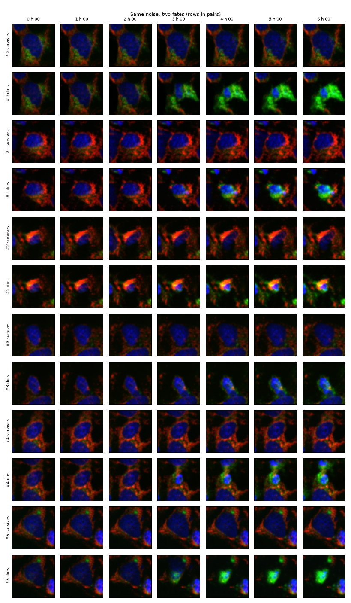
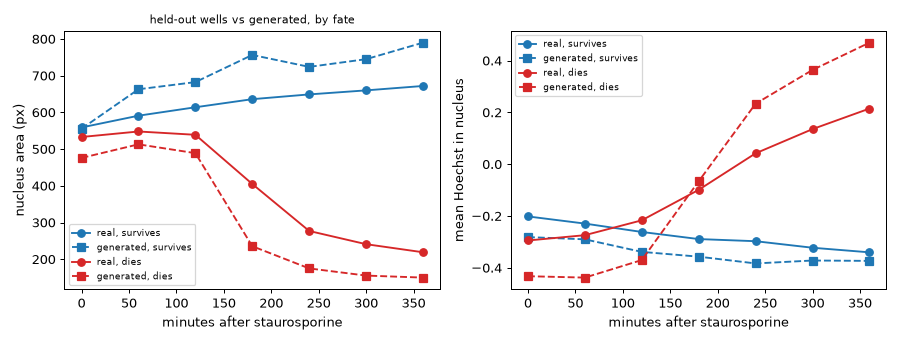
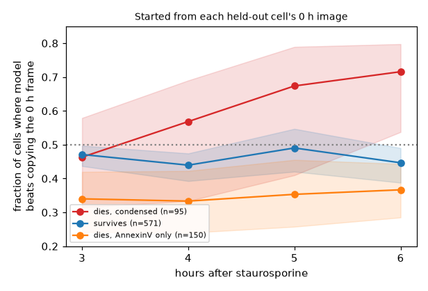
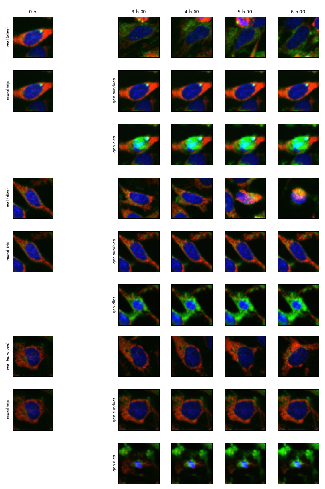
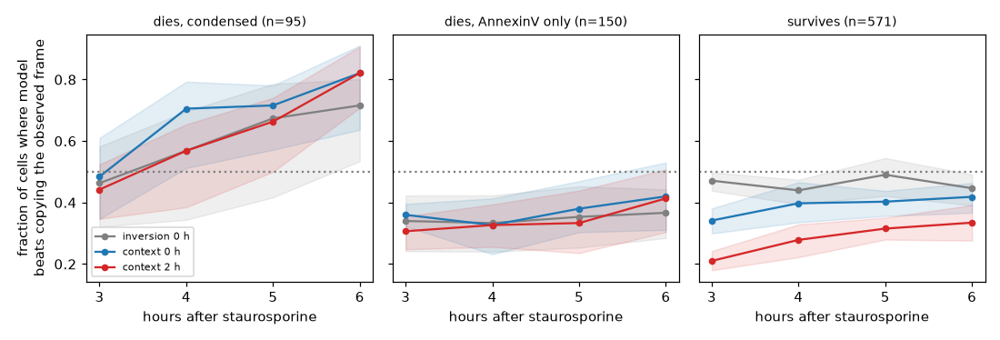

# static2fate

From one image of a drug-treated cell, can we tell which of two futures it will take, and when
that became decided?

Static2Dynamic ([Boyer et al., 2026](https://doi.org/10.64898/2026.05.18.725860)) generates a
video of a process from static snapshots, assuming one trajectory. This project works where the
same starting cells take two: HeLa cells under a staurosporine dose series, filmed every 30 min
for 6 h and then stained for AnnexinV, so every cell has a video and a known fate
([S-BIAD2515](https://www.ebi.ac.uk/biostudies/BioImages/studies/S-BIAD2515), Lippincott et al.,
Way lab, CC0).


Status (October 2026): data pipeline, baselines, a fate-conditioned generative model and a
version that also sees an earlier frame of the cell.

## What is here

- Nuclear segmentation, tracking over 13 frames and registration of the terminal AnnexinV image
  for all 30 wells (119 fields): 6,676 cells followed from start to end with a fate label.
- Fate label: AnnexinV above the control 90th percentile inside a cell mask, or a condensed
  nucleus (area halved, Hoechst doubled). Replicate wells agree within a few points.
- Single-cell crops (13 frames x 3 channels x 128 px) and single-frame fate baselines.

## Findings so far

| dose (nM) | 0 to 2.4 | 4.9 | 9.8 | 19.5 | 39.1 | 78 | 156 |
|---|---|---|---|---|---|---|---|
| fraction apoptotic at 6 h | 0.11 to 0.17 | 0.19 | 0.19 | 0.31 | 0.74 | 0.91 | 0.92 |

- Both fates occur in one band, 9.8 to 39 nM. Static2Dynamic's ChromaLive model was trained at
  78 and 156 nM, where nearly all cells die.
- From a single frame, fate is not readable before about 2 h and largely readable by 4 h
  (within 19.5 nM, leave-one-field-out AUROC 0.51 at 0 min, 0.60 at 2 h, 0.78 at 4 h, 0.84 at 6 h).
- Eleven handcrafted nuclear measurements match or beat frozen DINOv2 at every informative dose.
- A frozen video encoder does not see fate earlier either: V-JEPA 2 on frames 1 to 8 reaches
  within-dose AUROC 0.64 at 3.5 h against 0.68 for one frame of handcrafted features
  (difference -0.045, 95% CI -0.067 to -0.021; `results/tables/vjepa_vs_frame.csv`). It does
  beat DINOv2 averaged over the same frames at 2.5 h (+0.036, CI 0.007 to 0.067).


## First generative model

A small conditional flow-matching model (9.4 M parameters, written from scratch in
`src/static2fate/flow.py`) generates a 64 px cell image given the time after drug and the fate.
Trained 45 min on an Apple M5 Pro (MPS) on 1,919 cells; one replicate well per dose held out.

Starting from the same noise and asking for both fates gives two branches of the same cell. They
look the same up to 2 h and separate from 3 h, when the "dies" branch condenses its nucleus.



On held-out wells, generated dying cells change at the right time: nucleus brightness rises and
nucleus area falls between 2 and 3 h, as in real dying cells. They overdo it, though. At 6 h the
generated dying nucleus is 150 px against 219 px real, and Hoechst is 0.47 against 0.22. Survivors
come out about 15% too large. Nucleus is the Otsu object nearest the crop centre
(`src/static2fate/readouts.py`); an earlier fixed-threshold version exaggerated the size gap
because generated images are slightly dimmer.



## Starting from a real cell

Run the flow backwards from a held-out cell's 0 h image (fate left out) to get its noise, then
forwards under each fate to 3 to 6 h. The round trip gives the cell back almost exactly (pixel
MSE 0.002). Is the branch with the cell's true fate closer to what the cell actually looked like
later than simply copying its 0 h frame? On 816 cells from four held-out wells (distances on
nucleus area, nucleus Hoechst, cytoplasm green and red; 95% CIs from resampling the 12 fields):

| cells | 3 h | 4 h | 5 h | 6 h |
|---|---|---|---|---|
| die, nucleus condensed (95) | 0.46 | 0.57 | 0.67 | 0.72 (0.54 to 0.80) |
| survive (571) | 0.47 | 0.44 | 0.49 | 0.45 (0.39 to 0.49) |
| die, AnnexinV only (150) | 0.34 | 0.33 | 0.35 | 0.37 (0.28 to 0.44) |

So the dies branch predicts the course of cells that visibly die better than "nothing changes",
from 4 h on. The survives branch is close to a frozen copy of the first frame and adds nothing.
Cells that are AnnexinV-positive but still look normal at 6 h are pushed too far. In the images
the generated dying cytoplasm turns green, while real dying cells end as a condensed red and blue
body, so the colour of the change is wrong even when its timing is right.





## Giving the model an earlier frame of the cell

The model above has no notion of how far along a cell is. A second model (same network, context
image as three extra input channels, `scripts/13_train_ctx.py`, 60 min on MPS) is also given one
observed frame of the cell, at 0 to 3 h, and generates a later frame under each fate. Scored the
same way on the same 816 held-out cells (`scripts/14_eval_ctx.py`):

| cells, model beats copying the 0 h frame | 3 h | 4 h | 5 h | 6 h |
|---|---|---|---|---|
| die, condensed: inversion | 0.46 | 0.57 | 0.67 | 0.72 |
| die, condensed: context | 0.48 | 0.71 | 0.72 | 0.82 |
| die, AnnexinV only: inversion | 0.34 | 0.33 | 0.35 | 0.37 |
| die, AnnexinV only: context | 0.36 | 0.33 | 0.38 | 0.42 |
| survive: inversion | 0.47 | 0.44 | 0.49 | 0.45 |
| survive: context | 0.34 | 0.40 | 0.40 | 0.42 |

Paired on the same cells (`results/tables/ctx_vs_inversion_paired.csv`), context helps cells
that die with a condensed nucleus (+0.14 at 4 h, CI 0.06 to 0.24; +0.11 at 6 h, CI 0.03 to
0.21). It does not help the AnnexinV-only cells, which is what I added it for: they are still
pushed too far. For survivors it is worse at 3 h (-0.13, CI -0.17 to -0.08), because inversion
keeps the cell's own noise while the context model draws new noise for every sample, and for a
cell that barely changes that randomness costs more than the context gives. The overshoot of
dying nuclei is unchanged (163 px generated against 219 px real at 6 h). Given the 2 h frame
instead and compared with copying that frame, the pattern is the same
(`results/tables/model_vs_copy.csv`).



Looking at examples (`results/figures/fig9_context_examples.png`) also turned up a data
question: some cells round up with bright chromatin and flatten again an hour later. That looks
like division, not apoptosis, and a rounded mitotic cell can pass for a dying one in a single
frame.

## Are some "dying" cells dividing?

`scripts/16_divisions.py` flags a division when a nucleus turns small and bright for a frame or
two, comes back larger and dimmer within 1.5 h, and a new track is born next to it (the second
daughter). Apoptotic nuclei condense too but do not come back. Image strips for checking the
calls by eye are in `results/qc/divisions_*.png`: of the 16 flagged cells shown, about 10
clearly divide, 4 are unclear and 2 are dying cells.

| labelled cells (all 13 frames tracked) | n | divided | condensed in the last hour, AnnexinV negative |
|---|---|---|---|
| survive | 2,724 | 21 (0.8%) | 12 |
| die, condensed | 1,416 | 5 (0.4%) | 31 |
| die, AnnexinV only | 530 | 4 (0.8%) | 0 |

So divisions do not explain the AnnexinV-only problem: 4 of 530 cells. The second way mitosis can
enter the label is a cell caught rounding up at the end, which the "condensed" clause calls
apoptotic; mitotic cells are AnnexinV negative, so the 31 cells in the last column are the
suspects. By eye about a third of them look mitotic and the rest like ordinary apoptosis. At
most 40 of 1,946 dying cells (2.1%) are affected, probably fewer.

The bigger finding is what is missing. The nucleus count per field grows 6 to 17% over 6 h at
0 to 9.8 nM (`results/tables/nucleus_count_growth.csv`), so roughly a tenth of cells divide,
but only about 1% of labelled cells do. Division breaks the track (the nucleus rounds, moves and
splits), so dividing cells rarely end up with a complete track and a label. The labelled set,
and every model trained on it, is mostly cells that did not divide during the movie.

## Next

- Invert the context frame under the context model, so it keeps the cell's identity and uses
  its state.
- Score several samples per cell (energy score) instead of one, so a model is not penalised
  only for being stochastic.
- Link daughters to mothers in the tracker so dividing cells get a fate too; do cells that
  divide under drug die more or less often?
- Get the colour of apoptosis right; check whether the ChromaLIVE channel scaling per field is
  part of the problem.
- 128 px and longer training on a GPU (`kaggle/train_kaggle.py`, two T4s), then video.

## Run

```
uv sync
scripts/00_download_subset.sh          # all 30 wells, 45 GB, from EBI
scripts/run_all.sh                      # segmentation to baseline
uv run scripts/09_train_flow.py --minutes 45     # flow models, then 10 to 15 for evaluation
uv run scripts/13_train_ctx.py --minutes 60
uv run pytest
```

On a GPU: `uv run scripts/export_kaggle.py <user>` writes the 2,735 cells the models use
(1.7 GB) as a dataset folder; `kaggle/train_kaggle.py` trains from it on Kaggle.

Notes, decisions and corrections are dated in [notes/notebook.md](notes/notebook.md).

Known limits: one plate; the label fixes a 10% positive rate in controls; tracking keeps a
quarter to half of cells, fewer in dense regions, and almost none that divide; two deposited files are truncated and the
deposited terminal images need field matching (handled in `src/static2fate/fields.py`).
