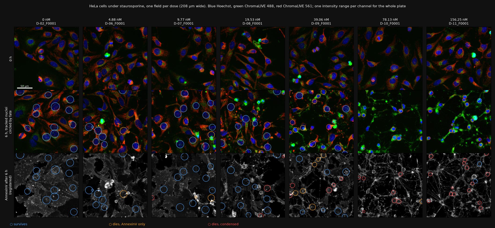
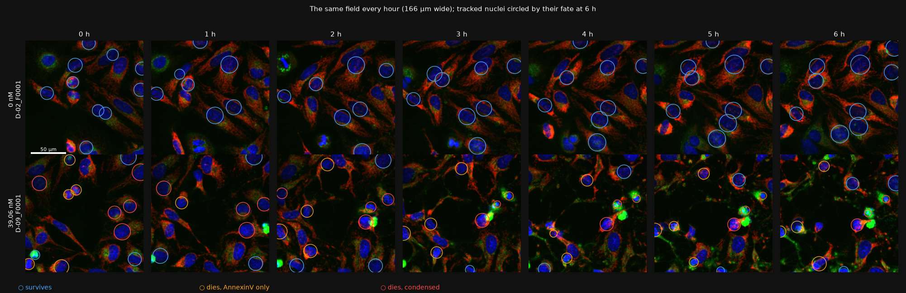
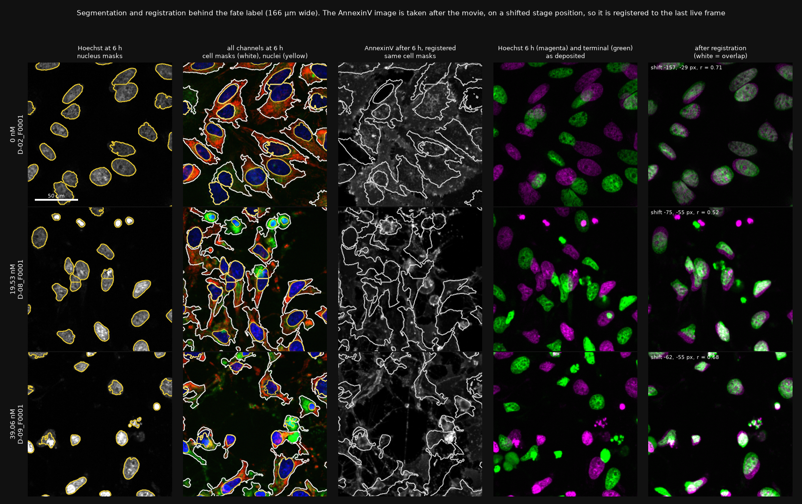
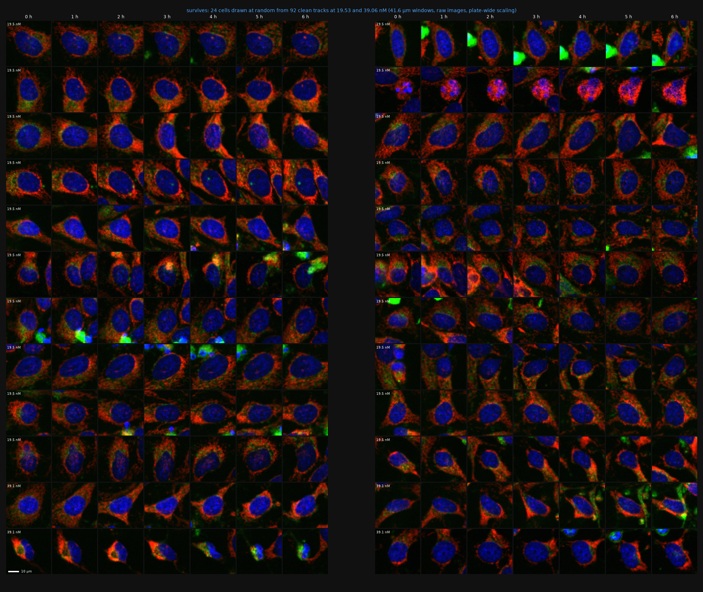
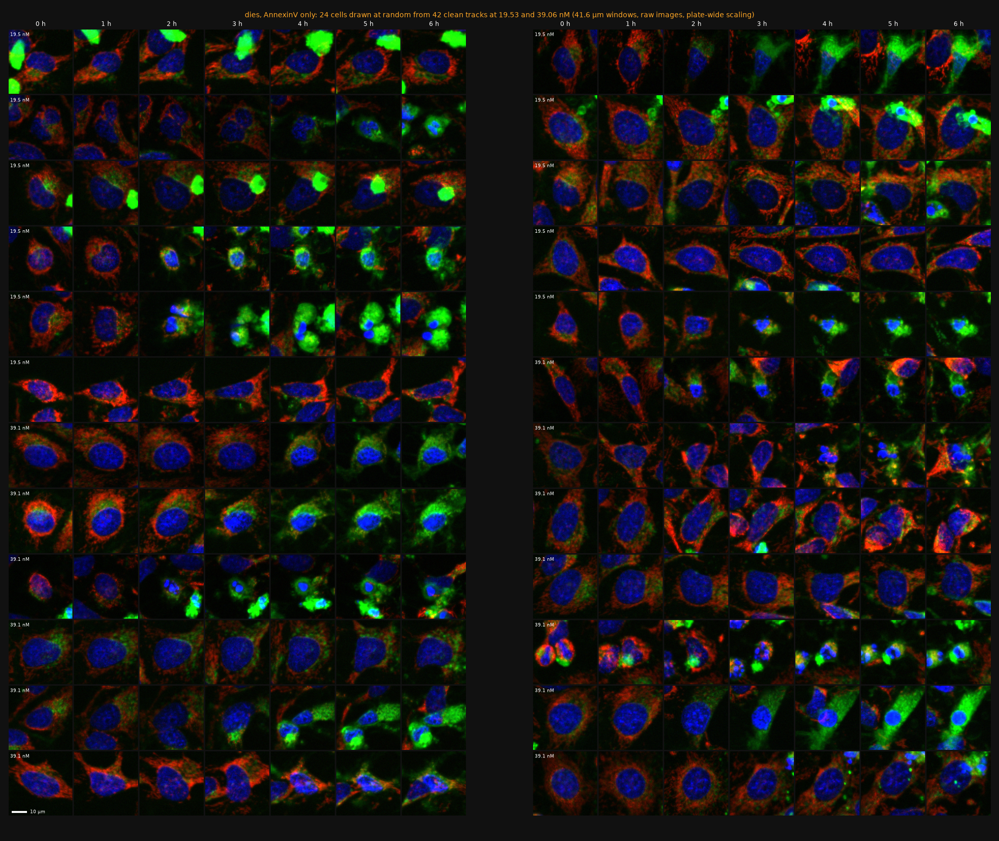
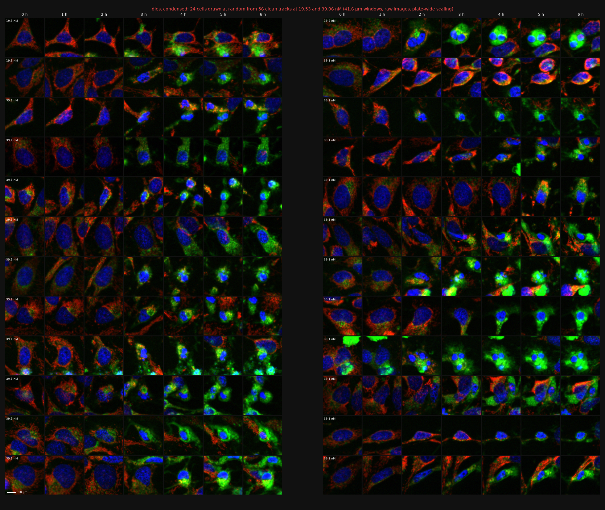
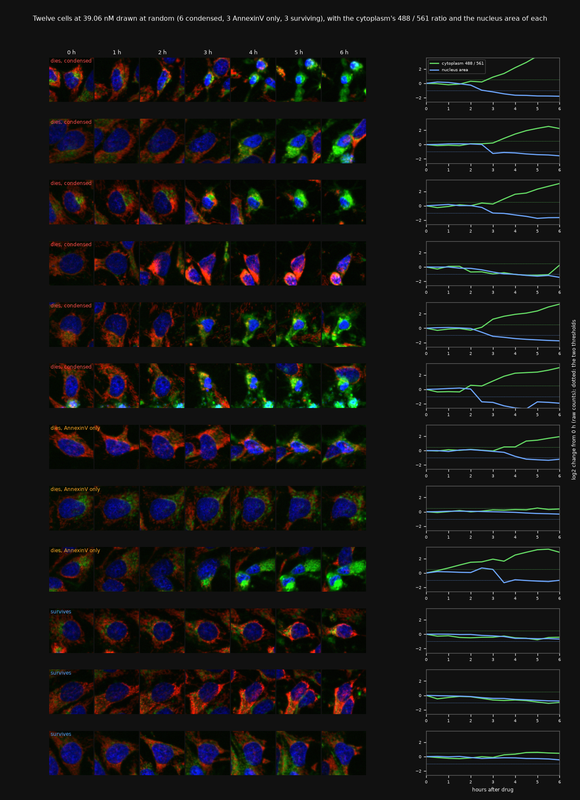
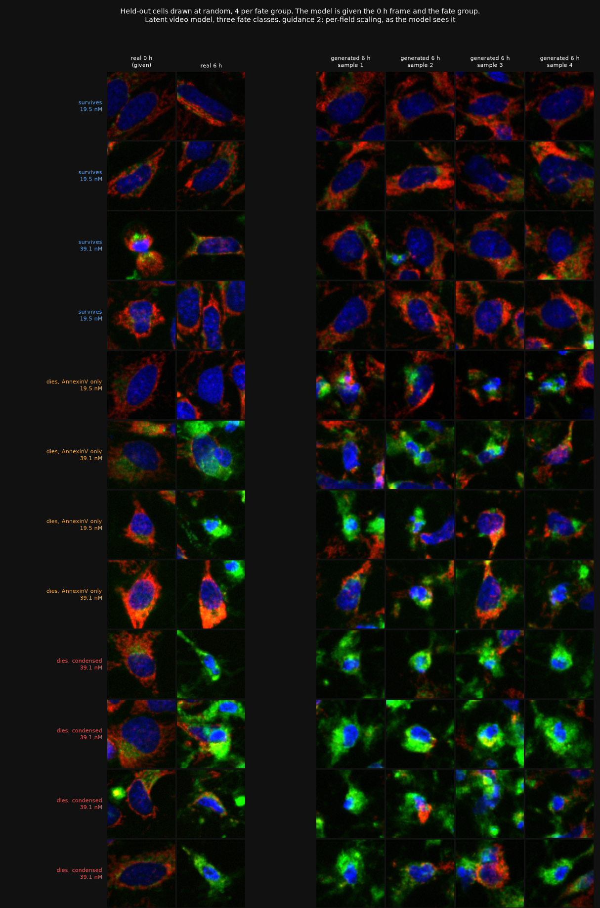
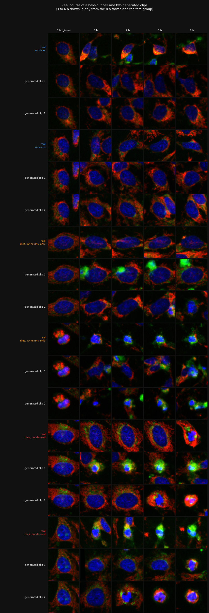
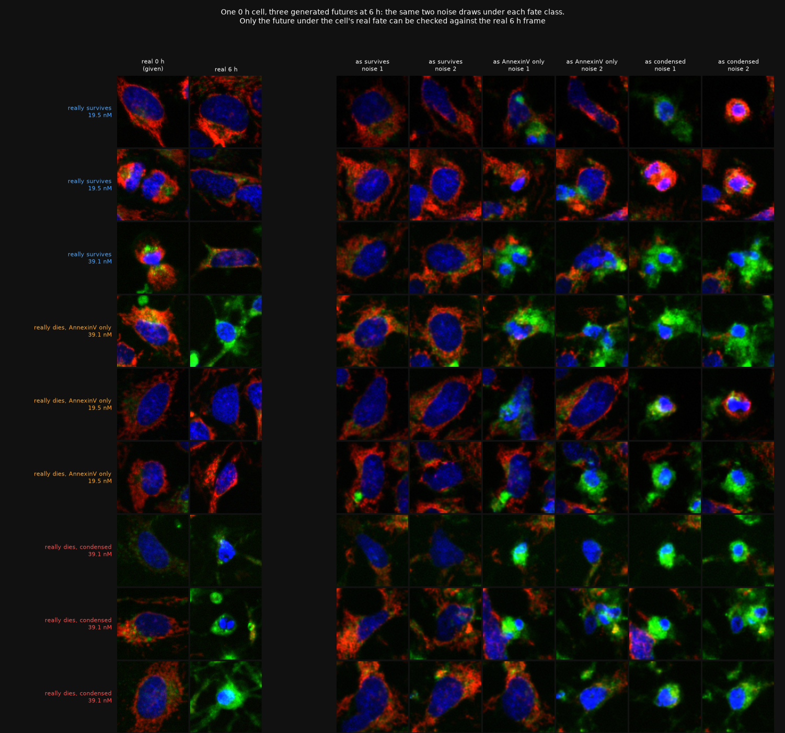

# Gallery

More images than the report has room for. Real cells first, then real against generated.

Convention for real cells: Hoechst blue, ChromaLIVE 488 green, ChromaLIVE 561 red, AnnexinV
grey; linear; one intensity range per channel for the whole plate
(`results/tables/display_ranges.json`); 0.325 µm per pixel. Cells and fields are drawn with a
fixed seed, not picked by eye, so the galleries include untidy and mislabelled cells. All
figures come from `scripts/47_gallery.py`.

## Fields

One field per dose at 0 h and 6 h, and the AnnexinV image taken after the movie. Circles mark
the tracked nuclei, coloured by fate group.

An untreated field and a 39.06 nM field, every hour.

Nucleus masks, cell masks and the registration of the endpoint image, for three fields.

A whole held-out field as a movie, with fate outlines: [field_E-08_F0001.gif](../results/movies/field_E-08_F0001.gif).

## Single cells, by fate group

Twenty-four cells per group at 19.53 and 39.06 nM, every hour, 41.6 µm windows cut from the raw
images around the tracked nucleus.

**Survives**

**Dies, AnnexinV only.** A mixture. Some of these cells look like survivors to the end, which is
what the label audit predicts (at these doses 22 to 38% of this group is threshold
background). Others turn green and start to shrink without meeting the condensation rule.

**Dies, condensed.** The nucleus shrinks and brightens and the cytoplasm turns from red to
green. A few cells in this group are divisions (two daughters, cytoplasm still red).

## The colour shift

Twelve cells at 39.06 nM with the cytoplasm's 488 / 561 ratio and the nucleus area over time.

## Real against generated

From here on the images are in the per-field scaling the model works in
(`scripts/05_crops.py`), so they are slightly brighter than the galleries above. Model: latent
video, three fate classes, guidance 2.

Held-out cells drawn at random: the real 0 h frame the model is given, the real 6 h frame, and
four generated 6 h frames under the cell's real fate group.

The 3 to 6 h course: the real cell, then two generated clips.

The same 0 h cell under each of the three fate classes, from the same two noise draws.

Movies of the real course next to three generated clips, three held-out cells per group:
[survives](../results/movies/cells_survive.gif),
[dies, AnnexinV only](../results/movies/cells_die_annexinv.gif),
[dies, condensed](../results/movies/cells_die_condensed.gif).
