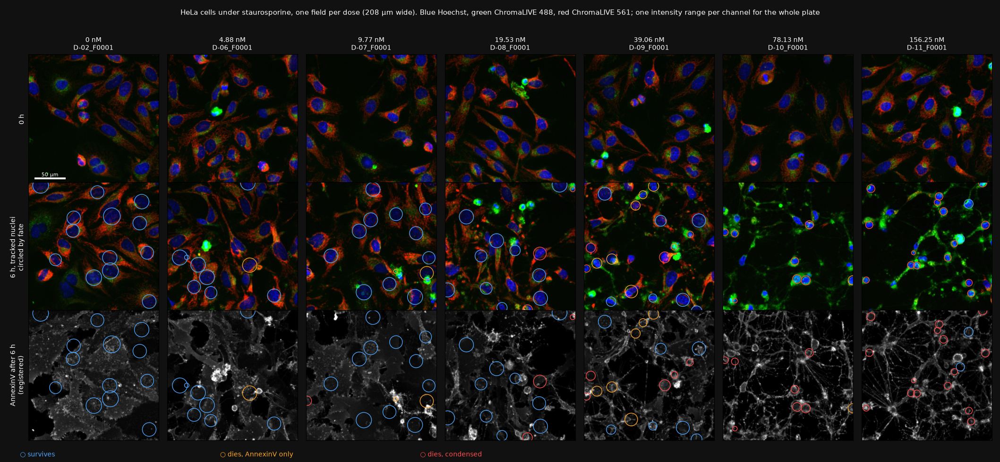
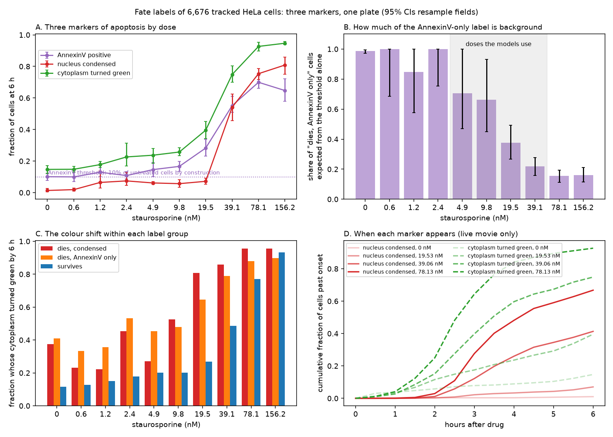
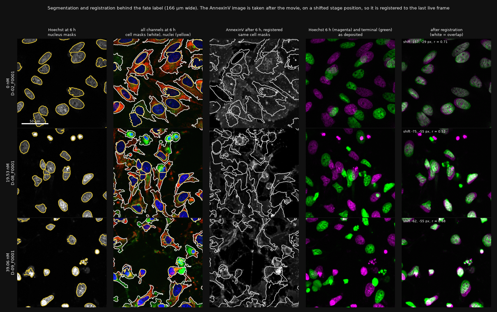
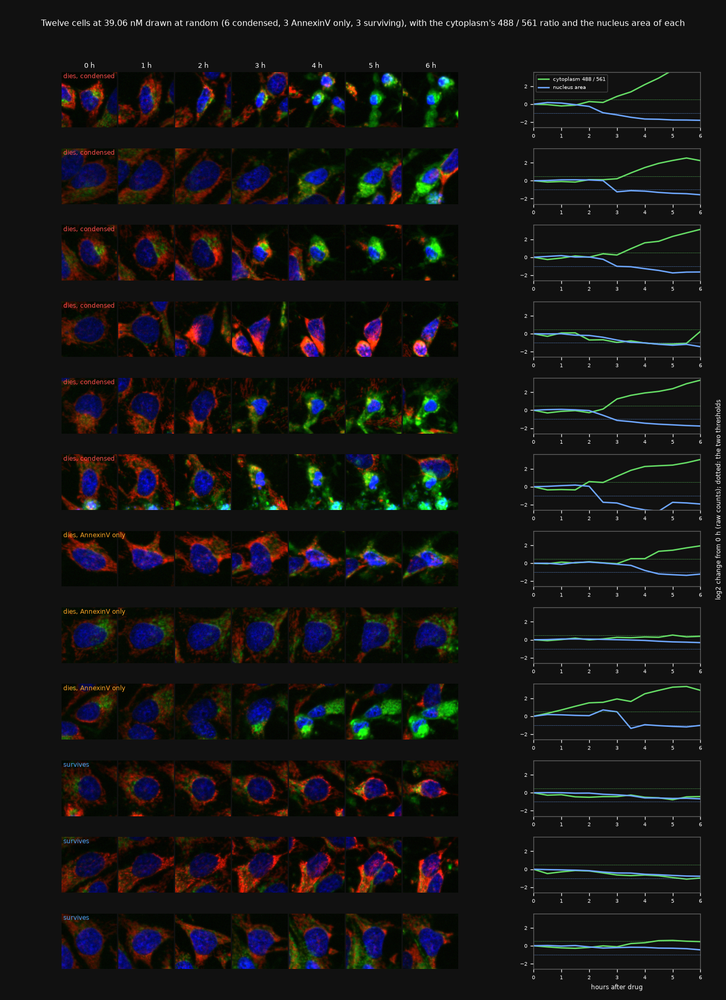
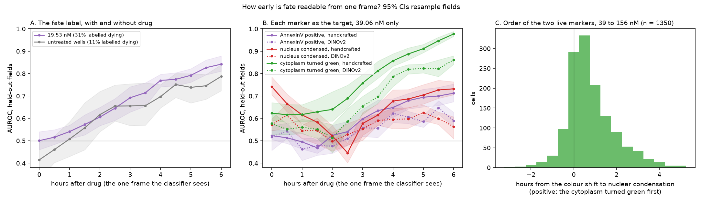
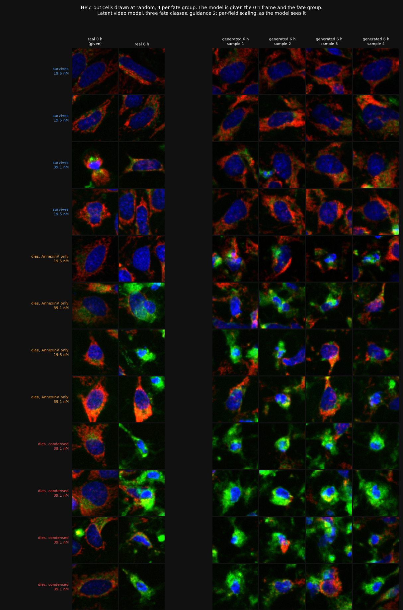
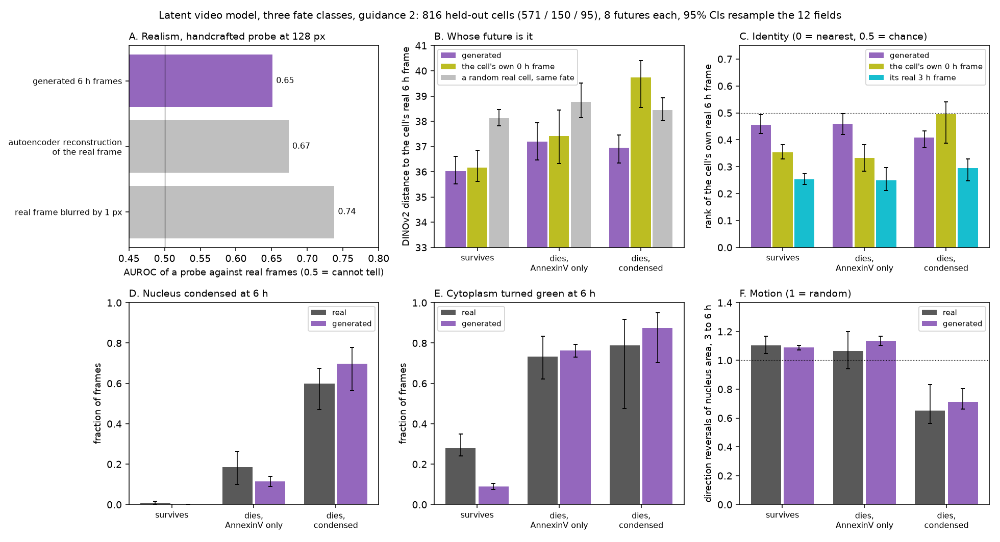
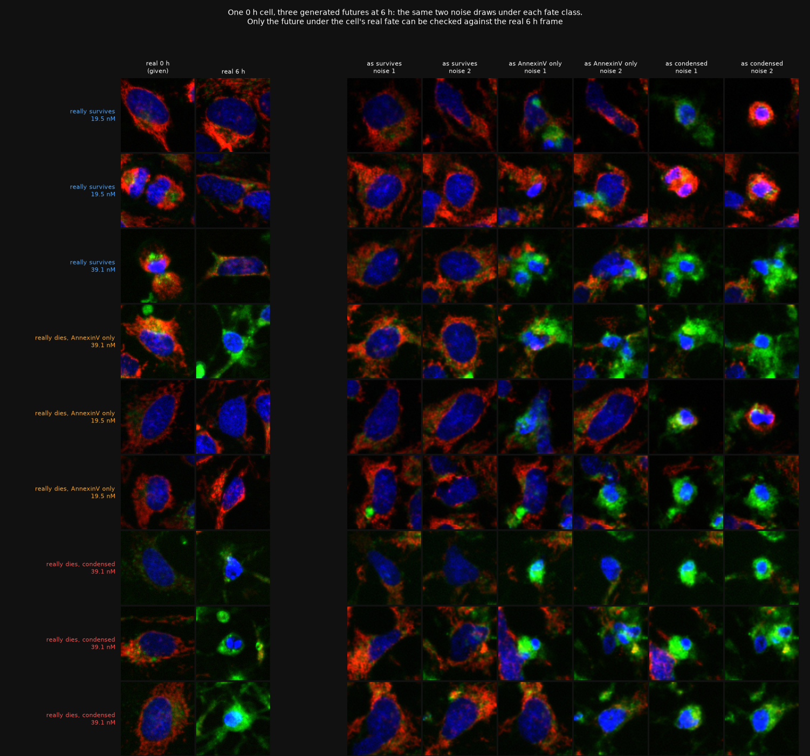

# static2fate: report

One plate of HeLa cells under a staurosporine dose series, filmed for 6 h and then stained for
AnnexinV ([S-BIAD2515](https://www.ebi.ac.uk/biostudies/BioImages/studies/S-BIAD2515),
Lippincott et al., Way lab, CC0). Static2Dynamic
([Boyer et al., 2026](https://doi.org/10.64898/2026.05.18.725860)) generates the video of a
process from static snapshots and assumes one trajectory. This project takes the case where
cells that look alike at the start end differently, and asks two questions:

1. From one image of a treated cell, how early can its fate be read?
2. Can a generative model, given the first frame and a fate, draw that cell's future?

Short answers. (1) Not before the cell starts to change: what a single frame reads from 2 to
4 h on is the event itself, and frozen DINOv2 and V-JEPA 2 features do not read it earlier than
eleven nucleus measurements. The earliest live marker is a colour shift of the cytoplasm,
about half an hour ahead of nuclear condensation. (2) Partly: the model draws realistic cells
with the right morphology, colour and motion for each fate, but its futures are no closer to
the cell's own real future than the cell's first frame is, except for cells whose nucleus
condenses. The weakest part of the project is the fate label, and section 2 measures how weak.

This page is the direct path. The 25 experiments behind it, dead ends included, are in
[log.md](log.md) in the order they were run. More images are in [gallery.md](gallery.md), and
[code_tour.md](code_tour.md) walks through the code.

## 1. Data

| | |
|---|---|
| Cells, drug | HeLa, staurosporine at 0, 0.61, 1.22, 2.44, 4.88, 9.77, 19.53, 39.06, 78.13, 156.25 nM |
| Plate | 30 wells: three wells per dose (rows C, D, E), dose increasing along the columns, 4 fields per well |
| Movie | 13 frames, every 30 min, 0 to 6 h; Hoechst, ChromaLIVE 488 (two channels), ChromaLIVE 561 |
| Endpoint | one image after the movie: Hoechst and AnnexinV |
| Image | 1900 x 1900 px, 0.325 µm per pixel (617 µm), 6,480 TIFF files, 45 GB |



*One field per dose at 0 h and 6 h, and the AnnexinV image taken afterwards. Every image of
real cells in this repository uses the same convention: Hoechst blue, ChromaLIVE 488 green,
ChromaLIVE 561 red, linear, one intensity range per channel for the whole plate
(`src/static2fate/display.py`).*

From images to single cells (`src/static2fate/fields.py`, `cells.py`, scripts 01 to 05):

| step | cells |
|---|---|
| nuclei segmented at 0 h in 119 fields (Otsu threshold and watershed on Hoechst) | 23,902 |
| tracked from 0 h to the endpoint image (trackpy, nearest-velocity prediction) | 7,503 |
| with a cell mask and an AnnexinV value, so with a fate label | 6,676 |
| at the four doses the generative models use (4.88 to 39.06 nM) | 2,735 |
| training wells (rows C and D) | 1,919 |
| held-out wells (row E, one well per dose, 12 fields) | 816 |

28% of the nuclei end with a label. Cells that divide are almost all lost, because a division
breaks the track.

## 2. The fate label, and how far to trust it

The label has two clauses (`scripts/04_fate_labels.py`). A cell is called dying if the
AnnexinV signal in its cytoplasm is above the 90th percentile of untreated cells, or if its
nucleus is condensed at the endpoint (area below half and Hoechst above twice its own 0 h
values). That gives three groups: **survives**, **dies, AnnexinV only** and **dies, condensed**.

`scripts/46_label_audit.py` checks the label against two markers that never touch the AnnexinV
image, both read from the live movie: nuclear condensation, and the colour shift of the
cytoplasm (the ChromaLIVE 488 / 561 ratio rising by more than 1.41x).



| dose (nM) | 0 | 4.88 | 9.77 | 19.53 | 39.06 | 78.13 | 156.25 |
|---|---|---|---|---|---|---|---|
| AnnexinV positive | 0.10 | 0.15 | 0.17 | 0.28 | 0.55 | 0.70 | 0.65 |
| nucleus condensed | 0.01 | 0.06 | 0.06 | 0.07 | 0.54 | 0.75 | 0.81 |
| cytoplasm turned green | 0.15 | 0.24 | 0.26 | 0.40 | 0.75 | 0.93 | 0.95 |
| share of "dies, AnnexinV only" explained by the threshold alone | 0.99 | 0.70 | 0.66 | 0.38 | 0.22 | 0.15 | 0.16 |

Four findings.

- **The AnnexinV clause has a 10% background by construction.** The threshold is the 90th
  percentile of untreated cells, so one untreated cell in ten is "dying". At 4.88 and 9.77 nM
  that background accounts for about two thirds of the AnnexinV-only group (0.70, 95% CI 0.47
  to 1.00, and 0.66, 0.45 to 0.93), at 19.53 nM for 0.38 and at 39.06 nM for 0.22. Over the
  four doses the models are trained on it is 44%.
- **AnnexinV misses a third of the cells that visibly die.** Only 63 to 72% of cells with a
  condensed nucleus are AnnexinV positive at 19.53 nM and above. The AnnexinV image is taken
  after the movie at a shifted stage position; after registration the Hoechst images of
  the last live frame and of the endpoint correlate at 0.5 to 0.7 in the three fields shown
  below, because dying cells move, round up or detach in between.
- **"Survives" means "not yet".** At 39.06 nM the cytoplasm has turned green in 49% of the cells
  labelled as surviving, and the fraction of condensed nuclei is still climbing at 6 h (0.26 at
  4 h, 0.41 at 6 h). The label is a snapshot of an ongoing process, censored at 6 h.
- **The two live markers agree with each other.** Of the cells whose nucleus condenses during
  the movie at 19.53 nM and above, 95 to 98% turn green, and in 61 to 73% of them the colour
  shift comes first, by a median of 0.5 h (1.25 h at 19.53 nM; `results/tables/label_audit_lag.csv`).

So the dose series has one dose where both outcomes are common under every marker, 39.06 nM,
and one where death is real but rare, 19.53 nM. At 4.88 and 9.77 nM the "dying" label is mostly
threshold background. The three groups are better read as stages reached by 6 h than as three
fates.



*What the label is measured on: nucleus masks, cell masks drawn on the last live frame, and the
endpoint image before and after registration.*

Twenty-four cells per group, drawn at random, are in the [gallery](gallery.md). Random draws
include mislabelled cells, for example a division called "condensed".



*Twelve cells at 39.06 nM drawn at random, with the cytoplasm's 488 / 561 ratio and the nucleus
area of each. In the raw counts the ratio goes from 1.0 to a median 5.6 in condensing cells by
6 h (488 up 2.3x, 561 down to 0.46x) and stays at 1.0 in survivors (`scripts/44_green_red.py`).*

## 3. Question 1: how early is fate readable from one frame?

A logistic regression on one frame, either eleven handcrafted nucleus measurements (area,
shape, channel means in the nucleus and in a ring around it) or a frozen DINOv2-base embedding
of the 128 px crop, always evaluated on fields the classifier has not seen.



- **The first version of this result does not survive a control.** With the fate label as the
  target, the AUROC within 19.53 nM rises from 0.50 at 0 h to 0.61 at 2 h, 0.77 at 4 h and
  0.84 at 6 h. In untreated wells, where the label marks only the top 10% of the AnnexinV
  readout, the same classifier gives 0.41, 0.62, 0.70 and 0.79 (panel A). Most of that curve is
  how well a late frame predicts a measurement taken just after it, with or without drug.
- **Within 39.06 nM, each marker as its own target** (panel B, leave one field out): the
  AnnexinV call is at chance until 2 h (0.52) and reaches 0.71 at 6 h; the colour shift goes
  from 0.64 at 2 h to 0.86 at 4 h. Both live markers start above chance at 0 h (0.62 and 0.74),
  but they are defined relative to the cell's own 0 h frame, so a 0 h measurement is part of
  their definition: with an absolute rule for condensation instead of the ratio rule, the 0 h
  association of nucleus area changes sign (`results/tables/label_audit_definition.csv`).
  There is no evidence here of a fate signal before the cell starts to change.
- **Frozen foundation encoders do not see it earlier.** From 3 h on, handcrafted measurements
  match or beat DINOv2 for every target. V-JEPA 2 on frames 1 to 8 reaches 0.64 at 3.5 h under
  the fate label against 0.68 for one frame of handcrafted measurements (difference -0.045,
  95% CI -0.067 to -0.021, `scripts/07_vjepa.py`).
- **The earliest marker is the colour shift**, half an hour before condensation (panel C).

## 4. Question 2: drawing the future of a cell

**The model.** A flow-matching model written from scratch (`src/static2fate/flow.py`,
`video.py`, `autoencoder.py`), in three parts:

1. A KL autoencoder turns a 128 px, three-channel crop into a 4 x 32 x 32 code (7.1 M
   parameters; L1, VGG16 perceptual and KL loss; 33.3 dB on held-out frames).
2. A UNet with FiLM conditioning predicts the velocity that moves noise to a code along a
   straight path. Temporal attention after each of its seven stages lets it draw the seven
   frames from 3 to 6 h as one clip (10.3 M parameters).
3. Conditions: the code of the cell's 0 h frame, concatenated to every frame, and the fate
   group as a class embedding. The fate is dropped 10% of the time in training so that
   classifier-free guidance can be used when sampling (50 Euler steps, guidance 2).

Trained for 6 h on one Kaggle T4 (90k steps, 16 clips per batch, seed 4) on the 1,919 training
cells. The model is told the fate. This is generation given the outcome, not prediction of it.





Scored on the 816 held-out cells, 8 futures each (`scripts/48_scorecard.py` collects the
numbers from scripts 20, 21, 22, 30, 42 and 45):

| | result | reference |
|---|---|---|
| A. Realism | a probe tells generated from real 6 h frames at AUROC 0.65 | 0.67 for the autoencoder's reconstruction of the real frame, 0.74 for a 1 px blur |
| B. Whose future | DINOv2 distance to the cell's real 6 h frame: 36.0 / 37.2 / 36.9 (survives / AnnexinV only / condensed) | the cell's own 0 h frame: 36.2 / 37.4 / 39.7; a random real cell of the same fate: 38.1 / 38.8 / 38.4 |
| C. Identity | the cell's real future ranks at 0.46 / 0.46 / 0.41 among held-out cells of its fate (0.5 is chance) | from its 0 h frame: 0.35 / 0.33 / 0.50; from its real 3 h frame: 0.25 / 0.25 / 0.29 |
| D. Condensed nucleus at 6 h | 0.00 / 0.12 / 0.70 of generated frames | real: 0.01 / 0.19 / 0.60 |
| E. Green cytoplasm at 6 h | 0.09 / 0.76 / 0.88 | real: 0.28 / 0.73 / 0.79 |
| F. Motion | nucleus-area reversals 1.09 / 1.14 / 0.71 | real: 1.11 / 1.07 / 0.65 |

What the model gets right: the look of each group (D, E), smooth motion in one direction for a
condensing nucleus (F), and texture close to what its autoencoder allows (A). What it does not:
it is closer to the cell's real future than the 0 h frame only for condensing cells, where the
0 h frame is stale (B), and its futures are less recognisable as this cell than the 0 h frame
is (C). It also makes survivors too uniformly red (E).



*The same 0 h cell drawn under each of the three fate classes from the same noise. Only the
future under the cell's real fate can be checked against data. Some "condensed" futures are a
round red cell, the look of a division: the model has learned the label, mislabelled cells
included.*

**One finding about guidance.** A two-class model (survives / dies) drew condensing nuclei for
36% of AnnexinV-only cells, against 19% in real cells. Resampling the same weights at guidance 1
instead of 2 gave 21%, but also took condensing cells from 63% down to 42% (real 60%). Guidance
is one knob on every effect of the label, so the fix is a label that says which way the cell
dies, not a different scale: three classes at guidance 2 give 12% and 70%
(`scripts/45_guidance_mixture.py`).

## 5. What did not help

Each line is one experiment in [log.md](log.md).

| tried | outcome |
|---|---|
| Starting the sampler part way from the cell's own image (SDEdit) | keeps the cell and loses the dynamics; no setting holds both ([log](log.md#starting-from-the-cell-instead-of-from-noise)) |
| Paired flow from the 0 h image to the later frame | identity still at chance, realism worse ([log](log.md#learning-the-change-instead-of-the-image)) |
| 8x the steps, 2x the resolution, 4x the parameters, 3x the cells, a VGG16 perceptual term | same scores; held-out loss equals training loss, so the floor is not capacity ([log](log.md#too-small-or-short-of-cells)) |
| Generating frames independently | nuclei jump between hours; fixed by the clip model ([log](log.md#the-future-as-one-clip-not-one-frame-at-a-time)) |
| A PatchGAN term in the autoencoder | lower fidelity at this budget ([log](log.md#what-survives-the-autoencoders-latent-and-what-the-probe-reads)) |
| Holding the 0 h neighbourhood fixed while sampling | every score worse; neighbours move too ([log](log.md#keeping-the-neighbourhood-by-hand)) |
| The energy score as the headline measure | it mostly rewarded spread between samples ([log](log.md#what-the-energy-score-was-counting)) |
| A DINOv2 probe for realism | saturated: it separates a half-pixel blur from the real frame at 0.87 ([log](log.md#what-survives-the-autoencoders-latent-and-what-the-probe-reads)) |

## 6. Limits

1. **One plate.** Dose runs along the columns and is not randomised; all held-out wells are in
   row E. Confidence intervals resample the 12 held-out fields, and the three wells of a dose
   differ more than that: at 39.06 nM the condensed fraction is 0.65, 0.50 and 0.44.
2. **The label** (section 2): a 10% background, an endpoint image that misses a third of
   condensing cells, and censoring at 6 h. Every per-group number inherits this, the
   AnnexinV-only group most of all.
3. **The model is given the fate.** Nothing here predicts fate, and the counterfactual futures
   cannot be checked cell by cell.
4. **Selection.** 28% of nuclei are tracked to the end, fewer in dense regions, and almost no
   dividing cell.
5. **One training run per model.** Differences between models were compared against a
   seed-matched control only once (three classes against two).
6. **Scaling.** The models work on crops scaled per field, and the Hoechst white point follows
   the death rate across doses (1.38x between 4.88 and 39.06 nM).
7. **The distance measure.** DINOv2 distance between crops is dominated by texture and by the
   neighbours; a 33 dB reconstruction is 28 units closer to the real frame than any sample.

## 7. Next

- **Replace the label by event times.** Onset of the colour shift and of condensation are read
  from the movie alone, per cell, with no threshold on a noisy endpoint stain. Condition the
  model on time to event (censored at 6 h) instead of a class, and score fate prediction as a
  time-to-event problem.
- **Work in a representation, not in pixels.** Texture decides both the realism probe and the
  DINOv2 distance. A video representation adapted to these images (the direction of V-JEPA 2
  world models) would let the model predict what changes in the cell and be scored on it.
- **Carry the cell.** Condition on the frames seen so far, not on one frame, and test identity
  directly.
- **Predict the field.** Neighbours die and move too; a crop model has to invent them.
- **A second plate**, with plate-wide intensity scaling and daughters linked to mothers.

## Reproduce

```bash
uv sync
scripts/00_download_subset.sh            # all 30 wells, 45 GB; one well: scripts/00_download_subset.sh C-08
scripts/run_all.sh                       # scripts 01 to 06: tracks, labels, crops, DINOv2 embeddings
uv run scripts/46_label_audit.py         # figures 2 and 5
uv run scripts/47_gallery.py real        # figures 1, 3 and 4
uv run pytest
```

The model was trained on Kaggle (`kaggle/ae`, `kaggle/fate3`); with its samples in
`results/kaggle/lat_video_fate3`, scripts 20, 21, 22, 30, 42, 44 and 45 score them and
`48_scorecard.py` and `47_gallery.py generated` draw figures 6 to 9.

## References

- Boyer et al., 2026. Static2Dynamic. [doi:10.64898/2026.05.18.725860](https://doi.org/10.64898/2026.05.18.725860)
- Lippincott et al., Way lab. S-BIAD2515, BioImage Archive, CC0. Analysis code: Zenodo [10.5281/zenodo.17419412](https://doi.org/10.5281/zenodo.17419412)
- Cottet et al., 2023, SLAS Discovery (the ChromaLIVE dye). [doi:10.1016/j.slasd.2023.10.005](https://doi.org/10.1016/j.slasd.2023.10.005)
- Ho et al., 2022. Video diffusion models. [arXiv:2204.03458](https://arxiv.org/abs/2204.03458)
- Gneiting and Raftery, 2007. Strictly proper scoring rules. [doi:10.1198/016214506000001437](https://doi.org/10.1198/016214506000001437)
