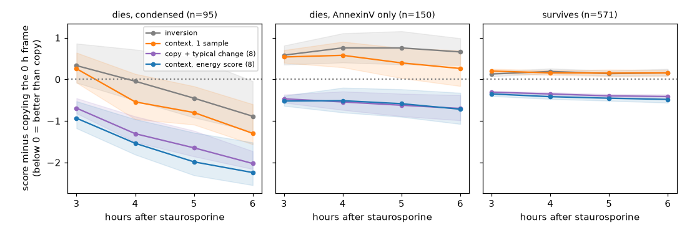
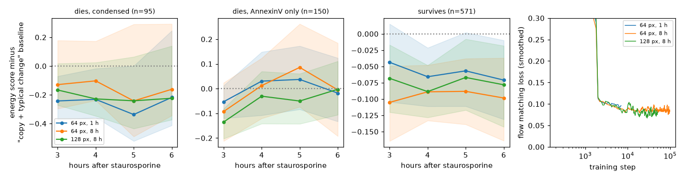
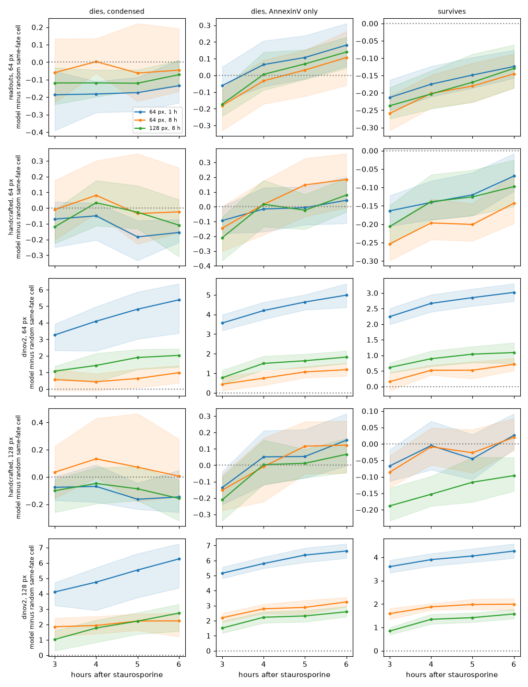
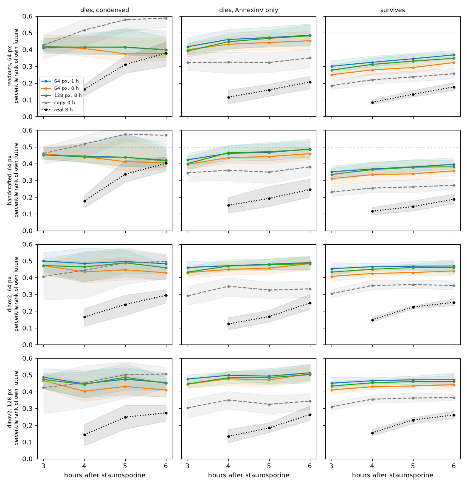
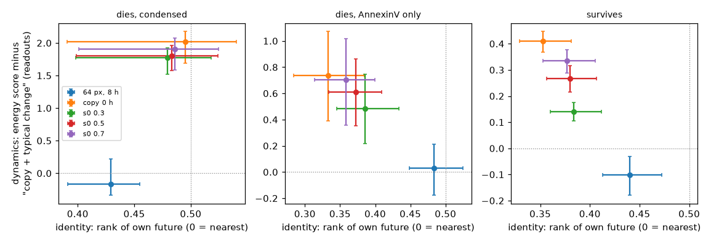
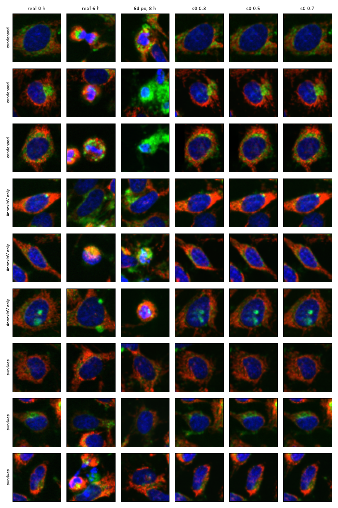
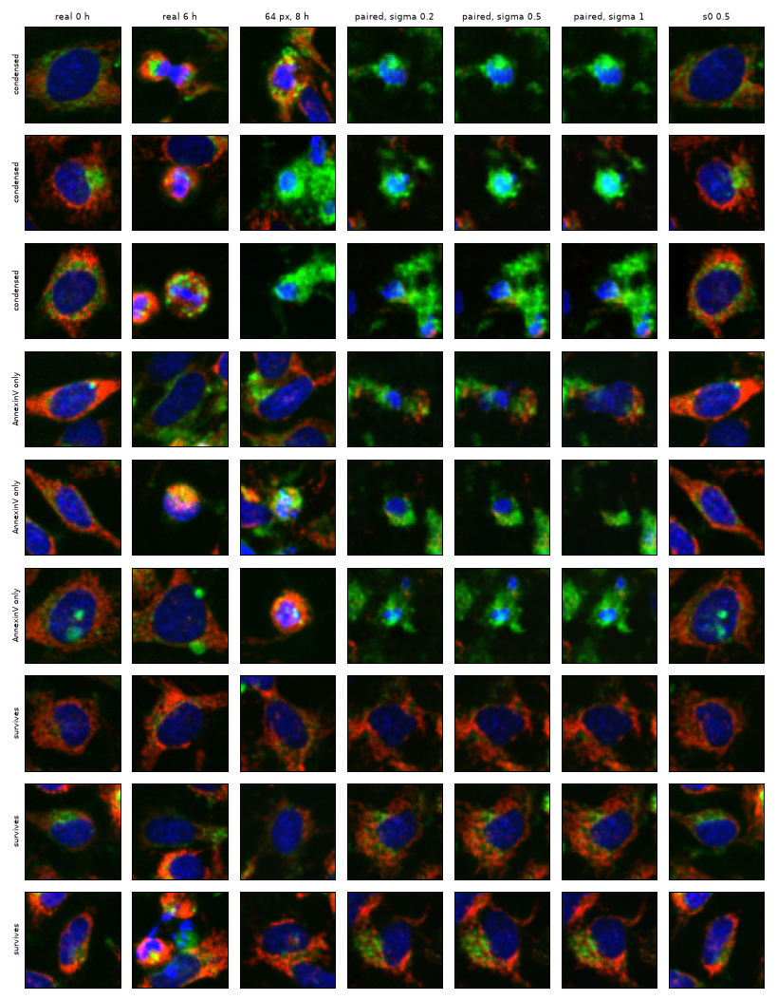
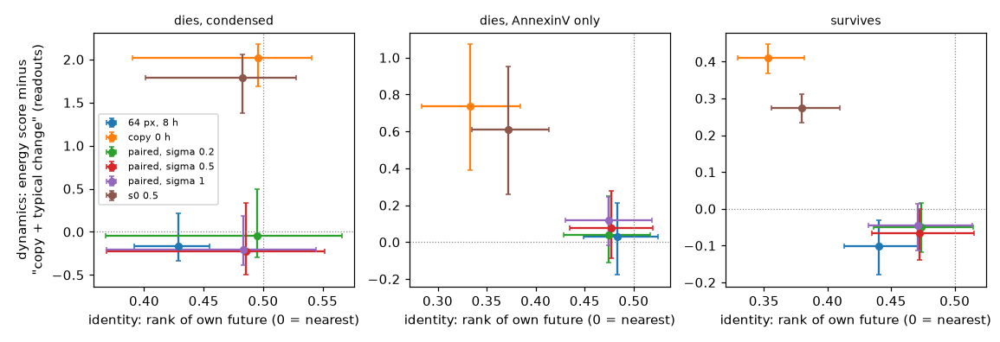
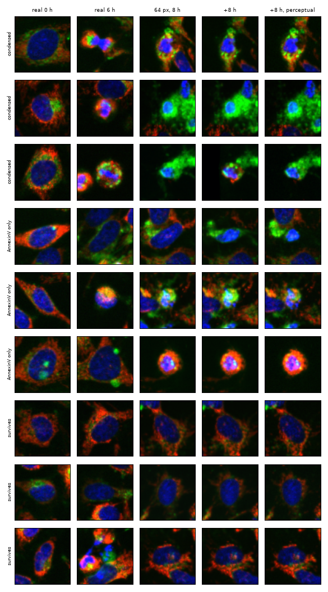

# static2fate: full results

Every experiment, table and figure, in the order it was run. The short summary is in the
[README](../README.md); dated notes, decisions and corrections are in
[notes/notebook.md](../notes/notebook.md).

Static2Dynamic ([Boyer et al., 2026](https://doi.org/10.64898/2026.05.18.725860)) generates a
video of a process from static snapshots, assuming one trajectory. This project works where the
same starting cells take two: HeLa cells under a staurosporine dose series, filmed every 30 min
for 6 h and then stained for AnnexinV, so every cell has a video and a known fate
([S-BIAD2515](https://www.ebi.ac.uk/biostudies/BioImages/studies/S-BIAD2515), Lippincott et al.,
Way lab, CC0).

Status (October 2026): data pipeline, baselines, a fate-conditioned generative model, a
version that also sees an earlier frame of the cell, and GPU runs showing that more training
or resolution does not change the picture.

## Findings so far

| dose (nM) | 0 to 2.4 | 4.9 | 9.8 | 19.5 | 39.1 | 78 | 156 |
|---|---|---|---|---|---|---|---|
| fraction apoptotic at 6 h | 0.11 to 0.17 | 0.19 | 0.19 | 0.31 | 0.74 | 0.91 | 0.92 |

- Both fates occur in one band, 9.8 to 39 nM. Static2Dynamic's ChromaLive model was trained at
  78 and 156 nM, where nearly all cells die.
- From a single frame, fate is not readable before about 2 h and largely readable by 4 h
  (within 19.5 nM, leave-one-field-out AUROC 0.51 at 0 min, 0.60 at 2 h, 0.78 at 4 h, 0.84 at 6 h).
- Eleven handcrafted nuclear measurements match or beat frozen DINOv2 at every informative dose.
- A frozen video encoder does not see fate earlier either: V-JEPA 2 on frames 1 to 8 reaches
  within-dose AUROC 0.64 at 3.5 h against 0.68 for one frame of handcrafted features
  (difference -0.045, 95% CI -0.067 to -0.021; `results/tables/vjepa_vs_frame.csv`). It does
  beat DINOv2 averaged over the same frames at 2.5 h (+0.036, CI 0.007 to 0.067).

## First generative model

A small conditional flow-matching model (9.4 M parameters, written from scratch in
`src/static2fate/flow.py`) generates a 64 px cell image given the time after drug and the fate.
Trained 45 min on an Apple M5 Pro (MPS) on 1,919 cells; one replicate well per dose held out.

Starting from the same noise and asking for both fates gives two branches of the same cell. They
look the same up to 2 h and separate from 3 h, when the "dies" branch condenses its nucleus.

On held-out wells, generated dying cells change at the right time: nucleus brightness rises and
nucleus area falls between 2 and 3 h, as in real dying cells. They overdo it, though. At 6 h the
generated dying nucleus is 150 px against 219 px real, and Hoechst is 0.47 against 0.22. Survivors
come out about 15% too large. Nucleus is the Otsu object nearest the crop centre
(`src/static2fate/readouts.py`); an earlier fixed-threshold version exaggerated the size gap
because generated images are slightly dimmer.

## Starting from a real cell

Run the flow backwards from a held-out cell's 0 h image (fate left out) to get its noise, then
forwards under each fate to 3 to 6 h. The round trip gives the cell back almost exactly (pixel
MSE 0.002). Is the branch with the cell's true fate closer to what the cell actually looked like
later than simply copying its 0 h frame? On 816 cells from four held-out wells (distances on
nucleus area, nucleus Hoechst, cytoplasm green and red; 95% CIs from resampling the 12 fields):

| cells | 3 h | 4 h | 5 h | 6 h |
|---|---|---|---|---|
| die, nucleus condensed (95) | 0.46 | 0.57 | 0.67 | 0.72 (0.54 to 0.80) |
| survive (571) | 0.47 | 0.44 | 0.49 | 0.45 (0.39 to 0.49) |
| die, AnnexinV only (150) | 0.34 | 0.33 | 0.35 | 0.37 (0.28 to 0.44) |

So the dies branch predicts the course of cells that visibly die better than "nothing changes",
from 4 h on. The survives branch is close to a frozen copy of the first frame and adds nothing.
Cells that are AnnexinV-positive but still look normal at 6 h are pushed too far. In the images
the generated dying cytoplasm turns green, while real dying cells end as a condensed red and blue
body, so the colour of the change is wrong even when its timing is right.

## Giving the model an earlier frame of the cell

The model above has no notion of how far along a cell is. A second model (same network, context
image as three extra input channels, `scripts/13_train_ctx.py`, 60 min on MPS) is also given one
observed frame of the cell, at 0 to 3 h, and generates a later frame under each fate. Scored the
same way on the same 816 held-out cells (`scripts/14_eval_ctx.py`):

| cells, model beats copying the 0 h frame | 3 h | 4 h | 5 h | 6 h |
|---|---|---|---|---|
| die, condensed: inversion | 0.46 | 0.57 | 0.67 | 0.72 |
| die, condensed: context | 0.48 | 0.71 | 0.72 | 0.82 |
| die, AnnexinV only: inversion | 0.34 | 0.33 | 0.35 | 0.37 |
| die, AnnexinV only: context | 0.36 | 0.33 | 0.38 | 0.42 |
| survive: inversion | 0.47 | 0.44 | 0.49 | 0.45 |
| survive: context | 0.34 | 0.40 | 0.40 | 0.42 |

Paired on the same cells (`results/tables/ctx_vs_inversion_paired.csv`), context helps cells
that die with a condensed nucleus (+0.14 at 4 h, CI 0.06 to 0.24; +0.11 at 6 h, CI 0.03 to
0.21). It does not help the AnnexinV-only cells, which is what I added it for: they are still
pushed too far. For survivors it is worse at 3 h (-0.13, CI -0.17 to -0.08), because inversion
keeps the cell's own noise while the context model draws new noise for every sample, and one
random sample is penalised for that spread (scored with several samples below, this goes away). The overshoot of
dying nuclei is unchanged (163 px generated against 219 px real at 6 h). Given the 2 h frame
instead and compared with copying that frame, the pattern is the same
(`results/tables/model_vs_copy.csv`).

Looking at examples (`results/figures/fig9_context_examples.png`) also turned up a data
question: some cells round up with bright chromatin and flatten again an hour later. That looks
like division, not apoptosis, and a rounded mitotic cell can pass for a dying one in a single
frame.

## Scoring several samples per cell

One sample from a stochastic model is a harsh test against a deterministic copy. So each
held-out cell got 8 samples per frame from the context model (0 h frame, true fate), scored with
the energy score (mean distance to the real readouts minus half the mean distance between
samples; for a single forecast it is the plain distance, so copy and inversion are on the same
scale; `scripts/17_energy_score.py`). Because the energy score credits spread, I added a
baseline that never looks at the image: the cell's 0 h readouts plus the change of a random
training cell with the same fate, 8 draws ("copy + typical change").

| energy score difference, 6 h (below 0 = first is better) | survive | die, condensed | die, AnnexinV only |
|---|---|---|---|
| context model vs copy | -0.48 (-0.57 to -0.41) | -2.25 (-2.55 to -1.52) | -0.72 (-1.08 to -0.33) |
| copy + typical change vs copy | -0.41 (-0.46 to -0.36) | -2.03 (-2.16 to -1.73) | -0.70 (-0.99 to -0.38) |
| context model vs copy + typical change | -0.07 (-0.13 to -0.01) | -0.22 (-0.41 to 0.25) | -0.02 (-0.13 to 0.12) |

Scored this way the context model beats copying the cell for every group and hour, survivors
included, and beats the inversion model everywhere. But most of that is what any forecast gets
by knowing the usual course of each fate. Beyond that baseline the images add a clear gain only
for cells that die with a condensed nucleus (-0.24, -0.23, -0.34 at 3, 4, 5 h, CIs below 0; at
6 h the CI crosses 0), a small one for survivors, and nothing for AnnexinV-only cells. Both the
model and the baseline are told the true fate, so this measures the dynamics given the fate,
not fate prediction. Distances are on four readouts only.

## Eight times the training, twice the resolution

Two more context models were trained on Kaggle (two T4 GPUs, 8 h each, `kaggle/`): the same
64 px model for 98,000 steps instead of 7,000, and a 128 px model for 51,000 steps. Scored on
the same 816 cells with the same 8-sample energy score, paired by cell
(`scripts/18_compare_models.py`, `results/tables/model_comparison.csv`):

| energy score minus the 1 h Mac model, 6 h | survive | die, condensed | die, AnnexinV only |
|---|---|---|---|
| 64 px, 8 h | -0.03 (-0.05 to 0.00) | +0.06 (-0.04 to 0.14) | +0.01 (-0.09 to 0.10) |
| 128 px, 8 h | -0.01 (-0.03 to 0.02) | -0.01 (-0.13 to 0.06) | +0.02 (-0.04 to 0.07) |

Nothing changes by more than 0.1 at any hour, and the few intervals that exclude 0 go both
ways (the longer run is a little better for survivors and a little worse for condensed dying
cells at 3 to 4 h). The training loss is flat from about 2,000 steps in all three runs. So on
this measure the model is not limited by compute or pixels. The next section shows the measure
was the problem.

## A finer comparison than four readouts

The sampled futures (8 per cell, kept as images by `scripts/19_generate_samples.py`) were
rescored in three feature spaces (`scripts/20_feature_score.py`): the four readouts, nine
crop-level nucleus measurements (area, eccentricity, solidity, nucleus and ring mean per
channel, `src/static2fate/features.py`) and frozen DINOv2-base embeddings, each standardised
on the real held-out frames; at 64 px, with everything averaged down, and at 128 px, with the
64 px samples upsampled and the real crops native. In DINOv2 space "copy + typical change" is a
linear extrapolation that leaves the manifold of real images, so the baseline there is a random
real training cell of the same fate at the same frame (8 draws). Energy score minus that
baseline at 6 h; below 0 means the model's futures are closer to this cell's real future than
another real cell of the same fate is:

| | 64 px, 1 h | 64 px, 8 h | 128 px, 8 h |
|---|---|---|---|
| readouts: survive / die condensed / die AnnexinV only | -0.12 / -0.13 / +0.18 | -0.15 / -0.05 / +0.11 | -0.13 / -0.07 / +0.14 |
| DINOv2 at 64 px | +3.0 / +5.4 / +5.0 | +0.7 / +1.0 / +1.2 | +1.1 / +2.0 / +1.8 |
| DINOv2 at 128 px | +4.3 / +6.3 / +6.6 | +2.0 / +2.2 / +3.2 | +1.6 / +2.7 / +2.6 |

In readout and handcrafted space the three models are still the same (paired differences
within 0.15, mixed signs), and each is slightly closer than a random same-fate cell for
survivors and condensed dying cells, not for AnnexinV-only cells. In DINOv2 space the 8 h
models are 1.9 to 4.4 units closer to the real future than the 1 h model, paired by cell, with
CIs excluding 0 in every group (`results/tables/feature_score_vs_1h.csv`). So the extra
training did change the images: they look more like real cells, which four readouts could not
see. At native 128 px the 128 px model is also closer than the upsampled 64 px model for
survivors and AnnexinV-only cells (1.6 against 2.0, 2.6 against 3.2), not for condensed ones.

Still, every model is farther from the cell's real future than a random real cell of the same
fate is, and a linear probe tells generated from real with AUROC 0.995 to 1.000 in DINOv2
space for all three (0.58 to 0.75 on the handcrafted features, 0.51 to 0.55 on the readouts;
`scripts/21_real_vs_generated.py`). DINOv2 distance here is mostly realism and time after
drug: the cell's own 0 h image is 17 units farther from its future than a random cell at the
right frame is. So it measures how real the futures look, not whether they are this cell's.

## Is it still the same cell?

The energy scores mix three things: realism, time after drug and whose cell it is. To isolate
the last, every real held-out cell of the same fate at the target frame is a candidate, the
candidates are ranked by distance to the query, and the percentile rank of the query cell's own
real future is recorded (0 = nearest, 0.5 = chance; `scripts/22_identity.py`). Queries: each
model's 8 samples (ranks averaged), the cell's own 0 h image, and its real 3 h image as a
reference for how recognisable a cell is from a real frame 1 to 3 h earlier.

| percentile rank of own future, 6 h | survive | die, condensed | die, AnnexinV only |
|---|---|---|---|
| DINOv2 at 64 px: models (1 h / 8 h / 128 px) | 0.47 / 0.44 / 0.46 | 0.48 / 0.43 / 0.46 | 0.49 / 0.48 / 0.48 |
| DINOv2: copy 0 h | 0.35 | 0.50 | 0.33 |
| DINOv2: real 3 h | 0.25 | 0.29 | 0.25 |
| readouts: models (1 h / 8 h / 128 px) | 0.37 / 0.32 / 0.35 | 0.40 / 0.38 / 0.40 | 0.49 / 0.45 / 0.48 |
| readouts: copy 0 h | 0.26 | 0.59 | 0.35 |
| readouts: real 3 h | 0.18 | 0.38 | 0.21 |

The generated futures keep little of the cell. In DINOv2 space their own future ranks near
chance (0.43 to 0.51), while the cell's 0 h image ranks it at 0.33 to 0.35 for survivors and
AnnexinV-only cells, and a real 3 h image at 0.25 to 0.29. Paired by cell, the models are 0.09
to 0.16 worse than the 0 h copy in those groups, CIs excluding 0
(`results/tables/identity_rank_paired.csv`). Only condensed dying cells change so much that
the 0 h image stops being useful (0.50; 0.59 in readouts, worse than chance), and there the
models match or beat it. Top-1 rates tell the same story: models 0.2 to 1%, copy 1 to 5%, a
real 3 h frame 5 to 34%. Longer training helps a little (64 px 8 h against 1 h: -0.03 for
survivors, CI -0.04 to -0.02), 128 px does not.

So in these feature spaces the generated future is not recognisable as this cell's. Whether
anything of the cell is kept is a separate question, answered further down with per-cell
correlations: the measurements are, the texture is not.

## Starting from the cell instead of from noise

The obvious fix is to start the sampler from the cell: integrate from part way along the
noise-to-image path, from (1 - s0) x noise + s0 x the 0 h image, as in SDEdit
(`scripts/23_keep_cell.py`, the 64 px 8 h model, s0 = 0.3, 0.5, 0.7, 4 samples per cell).
Identity and dynamics for each sampler on the same cells at 6 h (`scripts/24_tradeoff.py`):

| sampler | identity, rank of own future (survive / condensed / AnnexinV only) | dynamics, readout energy score minus baseline (same order) |
|---|---|---|
| from noise (64 px, 8 h) | 0.44 / 0.43 / 0.48 | -0.10 / -0.17 / +0.03 |
| s0 = 0.3 | 0.38 / 0.48 / 0.39 | +0.14 / +1.77 / +0.48 |
| s0 = 0.5 | 0.38 / 0.48 / 0.37 | +0.27 / +1.80 / +0.61 |
| s0 = 0.7 | 0.38 / 0.49 / 0.36 | +0.34 / +1.90 / +0.70 |
| copy of the 0 h image | 0.35 / 0.50 / 0.33 | +0.41 / +2.02 / +0.74 |

Starting from the cell does keep it (ranks move most of the way to the copy's), but at the
cost of nearly all the dynamics: already at s0 = 0.3 the condensed dying cells are as badly
predicted as by the copy, and survivors lose most of the gain. There is no strength in
between that holds both; the two ends of the trade-off are the model and the copy. The
partially noised images are also easier to tell from real ones on the handcrafted features
(probe AUROC 0.69 to 0.72 against 0.58). With straight-line flow matching the starting image
fixes the layout the model can no longer change, so identity has to be carried by the
conditioning, not by the starting point.

## Learning the change instead of the image

A paired flow: the path starts at the cell's own earlier image plus sigma x noise instead of
at Gaussian noise, and ends at its later frame, so the velocity field has to learn the change
of this cell (`scripts/25_train_paired.py`; sigma 0.2, 0.5 and 1, 45 min each on the Mac;
sampling starts from the real 0 h image plus the same noise). At 6 h:

| sampler | identity, rank of own future (survive / condensed / AnnexinV only) | dynamics (readouts, same order) |
|---|---|---|
| from noise (64 px, 8 h) | 0.44 / 0.43 / 0.48 | -0.10 / -0.17 / +0.03 |
| paired, sigma 0.2 | 0.47 / 0.50 / 0.48 | -0.05 / -0.04 / +0.04 |
| paired, sigma 0.5 | 0.47 / 0.49 / 0.48 | -0.07 / -0.23 / +0.08 |
| paired, sigma 1 | 0.47 / 0.48 / 0.48 | -0.05 / -0.21 / +0.12 |
| partial noise, s0 = 0.5, untrained start | 0.38 / 0.48 / 0.37 | +0.27 / +1.79 / +0.61 |

Trained on the paired path, the model does condense dying nuclei from a start that still
holds the cell, which the untrained partial-noise start could not. But the own future still
ranks near chance, at every sigma and every hour, and realism is worse (DINOv2 distance to a
random real cell 4 to 9 against 0.7 to 1.4 for the 8 h noise-start model, in part the 45 min
of training; probe on handcrafted features 0.64 to 0.73 against 0.58). The layout of the 0 h
cell survives in the images, but the model repaints the texture and the cytoplasm, and that
is what the feature spaces respond to.

## Does the model know this cell at all?

The ranking asks whether the generated future is the nearest real image to this cell's
future, a demanding test that a texture mismatch fails on its own. A looser one: across the
cells of a group, does the sampler's predicted readout rise and fall with the cell's real
readout? Spearman correlation at 6 h, prediction = mean over samples
(`scripts/26_percell_skill.py`, `results/tables/percell_skill_paired.csv`):

| readout, group | from noise, 8 h | copy 0 h | paired, sigma 0.5 | real 3 h |
|---|---|---|---|---|
| nucleus area, survive | 0.50 | 0.50 | 0.39 | 0.66 |
| nucleus area, die condensed | 0.35 | 0.42 | 0.31 | 0.52 |
| nucleus area, die AnnexinV only | 0.48 | 0.23 | 0.36 | 0.62 |
| cytoplasm red, die condensed | 0.38 | 0.19 | 0.24 | 0.55 |
| nucleus Hoechst, survive | 0.59 | 0.59 | 0.56 | 0.72 |

So the noise-start model does carry the cell: its per-cell predictions of nucleus size and
cytoplasm follow the real future as well as the 0 h copy does, and better for dying cells,
where the copy is stale. A real 3 h frame is the ceiling (0.5 to 0.7). What the ranking
punished is realism and texture, not the measurements. The paired models are below the
noise-start model here as well (0.39 against 0.50 for survivor nucleus area), so starting from
the cell added no per-cell information. The best model remains the context model sampled from
noise and trained 8 h; the next gains are in realism, not in the starting point.

## Training for realism

Two continuations of the 64 px, 8 h context model, another 8 h each on one T4
(`kaggle/continue/continue_kaggle.py`, 82k and 101k further steps, batch 64, seed 2): one
with the same loss ("+8 h"), one with a perceptual term added, the squared distance between
the model's current estimate of the clean image and the real one in frozen VGG16 features
(relu1_2, relu2_2, relu3_3, unit-normalised; `src/static2fate/perceptual.py`, weight 0.5,
"+8 h, perceptual"). VGG16 is not the evaluation encoder, so DINOv2 stays an independent
judge. Same scoring as before, 8 samples per cell, tag `_realism`.

| at 6 h, 64 px | 64 px, 8 h | +8 h | +8 h, perceptual |
|---|---|---|---|
| training MSE, last 20 logged steps | 0.084 | 0.086 | 0.085 |
| probe real vs generated, AUROC (DINOv2 / handcrafted / readouts) | 0.997 / 0.58 / 0.54 | 0.997 / 0.58 / 0.54 | 0.997 / 0.61 / 0.56 |
| DINOv2 energy score minus a random real cell (survive / condensed / AnnexinV only) | 0.68 / 0.97 / 1.40 | 0.68 / 0.80 / 1.20 | 1.39 / 0.67 / 1.64 |
| dynamics, readouts minus "copy + typical change" (same order) | -0.10 / -0.17 / +0.03 | -0.08 / -0.14 / +0.08 | -0.11 / -0.18 / +0.08 |
| identity, rank of own future in DINOv2 (same order) | 0.44 / 0.43 / 0.48 | 0.44 / 0.42 / 0.48 | 0.44 / 0.41 / 0.47 |
| per-cell skill, nucleus area (same order) | 0.50 / 0.35 / 0.48 | 0.50 / 0.34 / 0.39 | 0.51 / 0.24 / 0.46 |

Neither helped. The training loss had already flattened at 0.084 before the continuation
began and did not move in 8 more hours, and from the same noise draw the continued models
produce nearly the same image as the model they started from (mean absolute pixel difference
0.036 and 0.039 between models, against 0.16 between two samples of one model). The
perceptual term changed the texture a little in the direction VGG16 likes, and DINOv2
disagrees: survivors are now twice as far from a random real cell (1.39 against 0.68, 95% CIs
1.11 to 1.63 and 0.46 to 0.89) and the handcrafted probe separates a little more easily
(0.61 against 0.58). Dynamics, identity and per-cell skill are unchanged within their
intervals. So the realism gap is not a matter of training time or of the pixel loss alone: at
this capacity (a 64-channel UNet, 1,919 training cells) the model has learned what it can.

## Are some "dying" cells dividing?

`scripts/16_divisions.py` flags a division when a nucleus turns small and bright for a frame or
two, comes back larger and dimmer within 1.5 h, and a new track is born next to it (the second
daughter). Apoptotic nuclei condense too but do not come back. Image strips for checking the
calls by eye are in `results/qc/divisions_*.png`: of the 16 flagged cells shown, about 10
clearly divide, 4 are unclear and 2 are dying cells.

| labelled cells (all 13 frames tracked) | n | divided | condensed in the last hour, AnnexinV negative |
|---|---|---|---|
| survive | 2,724 | 21 (0.8%) | 12 |
| die, condensed | 1,416 | 5 (0.4%) | 31 |
| die, AnnexinV only | 530 | 4 (0.8%) | 0 |

So divisions do not explain the AnnexinV-only problem: 4 of 530 cells. The second way mitosis can
enter the label is a cell caught rounding up at the end, which the "condensed" clause calls
apoptotic; mitotic cells are AnnexinV negative, so the 31 cells in the last column are the
suspects. By eye about a third of them look mitotic and the rest like ordinary apoptosis. At
most 40 of 1,946 dying cells (2.1%) are affected, probably fewer.

The bigger finding is what is missing. The nucleus count per field grows 6 to 17% over 6 h at
0 to 9.8 nM (`results/tables/nucleus_count_growth.csv`), so roughly a tenth of cells divide,
but only about 1% of labelled cells do. Division breaks the track (the nucleus rounds, moves and
splits), so dividing cells rarely end up with a complete track and a label. The labelled set,
and every model trained on it, is mostly cells that did not divide during the movie.

## Next

- Invert the context frame under the context model, so it keeps the cell's identity and uses
  its state.
- Realism is the bottleneck: a frozen encoder separates generated from real without error,
  and texture, not the measurements, is what makes generated futures unrecognisable. Eight
  more hours of training and a VGG16 perceptual term changed nothing (the loss had
  flattened), so the next step is capacity and data, not the loss: a wider UNet trained on all
  labelled cells of the two-fate doses, or generation in the latent space of an autoencoder
  trained on these cells.
- Link daughters to mothers in the tracker so dividing cells get a fate too; do cells that
  divide under drug die more or less often?
- Get the colour of apoptosis right; check whether the ChromaLIVE channel scaling per field is
  part of the problem.
- Video: generate the whole 3 to 6 h course at once, with temporal consistency, instead of
  one frame at a time.
